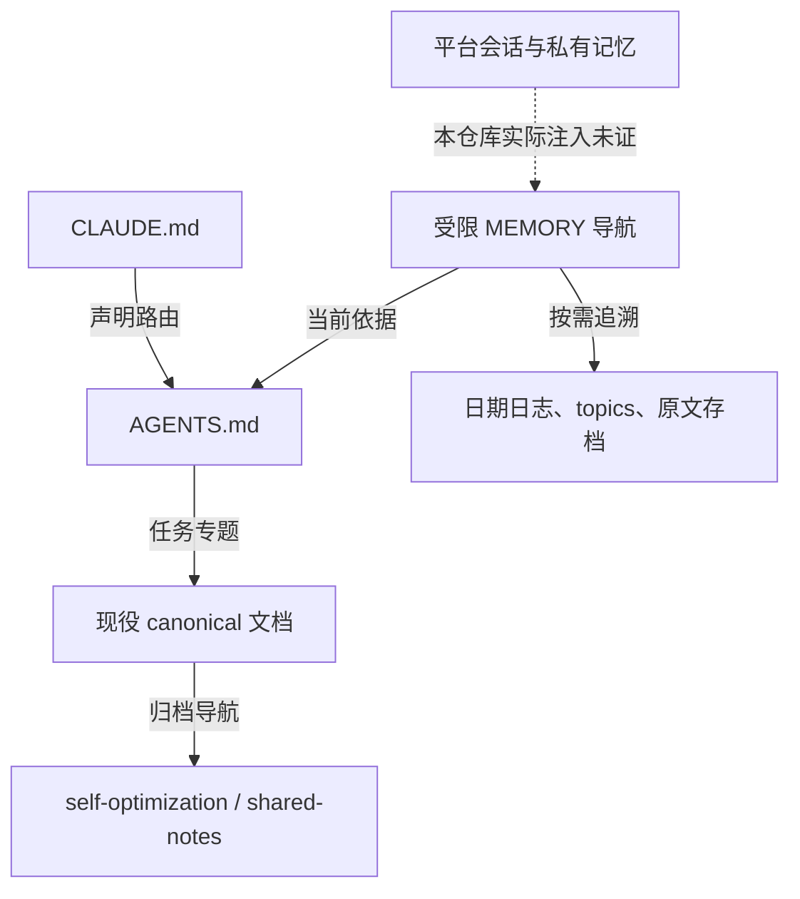

# 遗留 Agent 工程记忆可信度审计与治理

**审计日期**：2026-11-03。

**固定基线**：main / `cfb1952e88553d8e5138d7c3e9b883a9beb035d2`。

**文档角色**：一次性专项审计与候选裁决记录；不替代 AGENTS、专题合同或源码。

**交付状态**：隔离工作树中的未提交候选。没有 commit、push、merge、部署或关闭 Issue。

## 1. 结论与已完成工作

`.workbuddy/memory/MEMORY.md` 在内容层面已形成第二套工程规范：它同时维护编译矩阵、成功判据、恢复步骤、用户约定和强制 Git 工作流，并与现役合同出现分叉。最危险的是**历史权限与恢复捷径被写成当前强制动作**，其次才是参数、数值和路径过时。文件受 Git 跟踪、可以被读取已经确认；**Issue #185 对应会话是否真正注入该文件，未取得证据**，不能由目录名或平台通用功能反推事故因果。

本轮已完成工单 P0–P5 的授权范围：资产清查、源码及历史核验、逐项台账、归属裁决、原文保全、受限导航候选、最小检查器扩展及确定性回归。候选将活跃 MEMORY 改为路由，原文完整存入既有裁决存档；六份 topic 加历史角色及必要的定向更正，日期日志与参考脚本保持原样。唯一新迁入工具文档的经验，是已经核实的 linkage scanner `--help` 并非只读探测。另修正三处现役文档保证或验收摘要的漂移。

总台账 **209 条审计记录**，其中 **193 条来自记忆正文/参考资产，16 条是加载、治理、工单线索和 Issue 历史旁证**。仅记忆来源记录中，17 条有 FALSE 标签、12 条 STALE、23 条 CONFLICT、37 条 UNVERIFIED、9 条 UNSAFE_DIRECTIVE；标签允许重叠。这是风险导向样本，**不是全库错误率、事故数或某模型的幻觉率**。

主要交付：

- [逐项断言台账 claims.jsonl](agent-memory-trust-audit-2026-11-03/claims.jsonl)
- [逐项迁移映射 migration-map.tsv](agent-memory-trust-audit-2026-11-03/migration-map.tsv)
- [覆盖与前后效果 coverage-and-effects.json](agent-memory-trust-audit-2026-11-03/coverage-and-effects.json)
- [资产清单](agent-memory-trust-audit-2026-11-03/evidence/memory-inventory.json)、[身份与仓库树清单](agent-memory-trust-audit-2026-11-03/evidence/tracked-memory-inventory.json)
- [完整旧 MEMORY](裁决存档/workbuddy-memory-cfb1952e-2026-11-03.txt)、[字节保全核验](agent-memory-trust-audit-2026-11-03/evidence/preservation-check.json)
- [最终回归记录](agent-memory-trust-audit-2026-11-03/evidence/validation-summary.json)

## 2. 基线、范围与证据等级

审计从独立 clone 建立 detached worktree，初始受跟踪工作树状态为空。基线提交时间为 2026-11-03 10:29:57 UTC；11:43:30 UTC 再读远端 main，仍是同一完整 SHA。采用 blobless / sparse 读取控制大型二进制下载；完整 Git 树元数据用于确认文件存在，不能将未检出的本地文件误判成仓库缺失。完整文档硬门需要的对象与三个短 SHA 已补齐后再测。[基线记录](agent-memory-trust-audit-2026-11-03/evidence/repository-baseline.json)

### 2.1 实际资产

| 对象 | 数量与规模 | 本轮处理 |
| --- | --- | --- |
| 活跃 MEMORY | 1 份，107 行，16,190 字节 | 全文阅读，103 条原文断言；另两条资产/加载调查不混入此分母 |
| 日期日志 | 11 份，3,359 行 | 全部进入编译风险检索与上下文阅读；13 条编译、4 条权限/Git/头像历史定向抽样 |
| 六份 topic | 6 份，590 行 | 6/6 文件、590/590 行全文阅读；抽取69条断言 |
| 历史接入说明 | 1 份，89 行 | 全文阅读，2条断言 |
| XFL 参考 Python | 3 份，699 行 | 配置、解析器、入口、写入点定向静态审查；2条以脚本为源的记录；未执行 |
| Markdown 合计 | **19 份，4,145 行，399,577 字节** | 约390.2 KiB；不是工单中的初步18份估算 |
| `.workbuddy/memory` 全部资产 | **22 个受跟踪文件** | 没有在该目录外发现其他受跟踪 WorkBuddy 入口 |

读取文件比例不等于逐句语义覆盖率。11份日志中编译关键词命中258行，只是检索候选，不是断言全集，不能报告“13/258覆盖率”。没有对日志全部业务叙述、每项美术调整、全部历史性能数字逐条重验。三个参考脚本的699行是文件规模，不代表逐分支测试。台账逐条给出来源、原行、判定、证据、范围、归属与动作；`source_line` 对应固定基线，候选加抬头后的行号不作为历史定位。

另读取 CLAUDE、项目 `.claude/settings.json`、AGENTS、shared-notes、自优化、harness、文档治理和相关技术合同。MEMORY 的历史调查取得22条路径提交元数据、18个内容快照，并在首个失真提交处同时读取当时的编译脚本。此覆盖没有扩张成全仓 Markdown 的句级审计。

### 2.2 证据口径

证据优先级依次是当前源码/机器真源、与基线绑定的确定性实验、具完整输入身份的历史运行收据、Git 历史与现役文档、历史 Agent 自述。历史自述可以保留调查价值，但不能变成本轮运行验收。对冲突条目，台账的 `recommended_action` 与 `applicability` 已给出优先来源和处理，而非停留在“双方冲突”。`confidence` 表示本轮裁决把握，不是统计概率；保留的早期数值分值也不应作模型准确率。

风险等级用于排整改顺序：P0是可能破坏恢复状态或终止他人宿主的执行指令；P1影响权限、构建可信度或重要业务判断；P2为有范围的知识/环境偏差；P3为低影响历史细节。**标为P0不表示已观察到相应事故发生。**

| 状态 | 全部209记录 | 其中193条记忆来源 | 活跃MEMORY的103条 |
| --- | ---: | ---: | ---: |
| VALID | 102 | 94 | 57 |
| STALE | 13 | 12 | 4 |
| FALSE | 20 | 17 | 7 |
| CONFLICT | 25 | 23 | 14 |
| UNVERIFIED | 41 | 37 | 20 |
| LOCAL_ONLY | 29 | 29 | 16 |
| HISTORICAL | 50 | 45 | 14 |
| DUPLICATE | 34 | 34 | 29 |
| UNSAFE_DIRECTIVE | 9 | 9 | 6 |

全记录风险分布为P0 3、P1 66、P2 134、P3 6。状态列不能相加。工单关于“tracked diff也排除.workbuddy”的线索被证伪，单独标成 `task_hypothesis`，没有算成记忆自身的错误。默认加载机制、目录清单也与原文断言分开。

## 3. 加载与权威关系

实线表示仓库中已核实的声明或候选链接关系，**不表示某次会话已读取**；虚线表示本仓库/事故会话中尚未证实的注入。当前用户授权决定操作边界，源码和对应合同决定工程事实。



| 入口 | 已核实 | 不能据此推出 |
| --- | --- | --- |
| `.workbuddy/memory` | 22个文件受Git跟踪；MEMORY链接topic、当前候选还链接canonical与存档 | 自动加载规则、截断阈值、#185实际输入 |
| CLAUDE | 8行入口，明确指向AGENTS与专题按需路由 | 每个链接内容都被自动展开或每次全量预读 |
| `.claude/settings.json` | 仓库配置列出宽泛Bash/Edit/Write/Read/Agent等allow；未发现记忆hook | 用户授权、最终生效权限或实际滥用已经发生 |
| shared-notes | 被自优化流程引用，含有日期的头像campaign计数与能力经验 | 旧计数是当前验收、这些内容每次都进入prompt |
| Claude Auto Memory | 官方默认位置在用户目录，项目规范也给出该指针 | 用户/托管设置没有覆盖；实际私有记忆必在仓库外；其内容已经污染 |

[WorkBuddy官方记忆说明](https://www.codebuddy.cn/docs/workbuddy/From-Beginner-to-Expert-Guide/Function-Description/Memory)描述了相关记忆作为背景、提示词注入和历史检索，也提示概括偏差与时效性风险。这支持“平台具备传播渠道”，不证明仓库中这个旧目录正是该机制的输入。[Claude官方说明](https://code.claude.com/docs/en/memory#storage-location)区分项目指令与自动记忆，并支持位置覆盖；本轮没有取得用户/托管配置或会话加载日志。没有把Claude的限额或CodeBuddy CLI的目录约定套到WorkBuddy桌面上。

`.gitignore` 已排除 `.workbuddy` / `.workbuddy-ai`，但忽略规则不取消已有文件跟踪。原文件同时写历史事实和“必须遵守”的当前命令，即使自动注入未证，普通检索也能将它们带入决策。治理应解决这种可见的角色混淆，不需要先证明一场事故的完整传播链。[ROOT-043–053；台账与Git树清单]

## 4. 主要风险与可复核裁决

| 优先级 | 断言与实际证据 | 裁决与影响 | 台账 |
| --- | --- | --- | --- |
| P0 | 确认Flash/任务静止或“无残留”后删除uncertain marker | 漏掉scratch恢复、原件身份、迟到产物/诊断、exact-owned marker等前提；不能作为恢复流程 | COMP-024、029 |
| P0 | 日志按进程名强制结束全部Flash Player | 可能终止他人宿主；只能保留事故历史文本 | COMP-043 |
| P1 | 每次改代码前fetch并merge；SWF冲突一律取theirs占位后重编 | 跨任务权限漂移，可能破坏冻结基线/并行工作树，并让占位产物被误认有效 | ROOT-038、042 |
| P1 | “Please continue”这种字面文本一定由平台注入；提交消失便按摘要重放 | 消息来源与操作归属未证；可能忽略真实指令或重放已失效改动 | ROOT-034、036 |
| P1 | `levels` 是编译Target | 引入时与当前resolver均无此别名；不是需要保兼容的旧协议 | COMP-009 |
| P1 | Node是统一的编译前置；0/0与SWF刷新足以验收所有目标 | 需要按目标、阶段和运行证据区分；不能反向改成asLoader完全不需要Node | COMP-015–023 |
| P1 | Web头像首次失败先hidden；profiles只有两个运行消费者；generated-manifest零消费者 | 前者是错误“更正”；C#是第三个直接消费者；生成器读取manifest并在check时比较 | ROOT-014、016、022 |
| P1 | 全局技能必须80槽、含“被动”都不可装备 | 当前85槽；80是单NPC目录键上限；Passive与Equippable的判断不同 | SEM-038、044 |
| P1/P2 | 封印Y偏移/Z半径80、手套倍率2/1.5；敌人固定乘全局难度 | 当前120与5/2；61路线有单位倍率冻结分支，旧简式不能通用 | SEM-009、028、029、033 |
| P1 | asset_source_map是运行linkage注册；CWS出现字符串即可证明attachMovie有效 | 索引、导出、挂载、实际运行是不同证据层级，不能互相替代 | SEM-061、068、089 |
| P1/P2 | 改Host必走某两步；必须使用某用户名的Python；所有XFL修改都要再问 | 有的是已更新工具的旧workaround，有的是局部会话要求；当前任务和现役合同优先 | ROOT-011、024、026、029 |

### 4.1 编译边界应如何表述

当前 `compile_test.ps1` 的别名来自resolver：test/testloader、publish/asloader、main/mainfile/empire；default接受显式路径。候选检查器从这段源码提取支持集，没有复制七个常量。[resolver](https://github.com/FlashNightModReborn/CrazyFlashNight/blob/cfb1952e88553d8e5138d7c3e9b883a9beb035d2/scripts/compile_test.ps1#L361-L380)

缺Node的后果分三阶段：显式TestLoader在触发前硬失败；其他目标的预编译BOM检查缺Node时警告并跳过；asLoader/main/flashswf产物后验收仍调用Node类嵌入审计。因此删除笼统前提后，应回到所属合同，不写“asLoader不依赖Node”。[触发前门与BOM检查](https://github.com/FlashNightModReborn/CrazyFlashNight/blob/cfb1952e88553d8e5138d7c3e9b883a9beb035d2/scripts/compile_test.ps1#L384-L460)、[产物后验收](https://github.com/FlashNightModReborn/CrazyFlashNight/blob/cfb1952e88553d8e5138d7c3e9b883a9beb035d2/scripts/compile_test.ps1#L661-L669)

Compiler 0/0、marker、SWF时间戳、旧发布物反编译都各有范围。TestLoader还需要本轮suite/runId行为闭合、失败哨兵和事务恢复；生产SWF需要类归属等产物证据。历史MEMORY的第二份简版恢复合同已移出，当前规则仍由 [testing-details](../agentsDoc/testing-details.md#flash-recovery) 与 [CS6指南](../scripts/FlashCS6自动化编译.md)维护。

### 4.2 一个被“更正”污染的具体案例

MEMORY:42声称Web头像onerror先hidden，再设置默认图。当前三处实际逻辑先安装第二次失败处理，再切换默认图；只有默认图再次加载失败才hidden。2026-09-26对应历史提交的实现也相同，因此不能用“源码后来改了”解释这次误读。对源码提取的三个handler做隔离求值，首次保持visible、第二次才hidden，3/3通过；此探针验证控制流，不冒充浏览器像素验收。[当前实现](https://github.com/FlashNightModReborn/CrazyFlashNight/blob/cfb1952e88553d8e5138d7c3e9b883a9beb035d2/launcher/web/modules/tasks/task-panel.js#L1069)、[历史实现](https://github.com/FlashNightModReborn/CrazyFlashNight/blob/f495419e3b77f042f20bd287ed1f9d83e8b0fe16/launcher/web/modules/tasks/task-panel.js#L1067)、[探针](agent-memory-trust-audit-2026-11-03/evidence/avatar-onerror-probe.json)

当前 `室友.png` 是受跟踪的400×400全透明PNG、1,153字节；MEMORY一处说已经删除，另一处记录旧700字节样本。前者已过时；后者明确属于历史实验，当前压缩大小不同**不能反证旧样本**。透明图片加载成功也不会触发Web默认图回退，因而“透明图与删除完全等价”不成立；C#透明图会抑制首字兜底的提醒仍有源码支持。[图像探针](agent-memory-trust-audit-2026-11-03/evidence/roommate-image-probe.json)

## 5. 失真是怎样形成并留存的

### 5.1 路径片段被晋升成命令

| 历史提交 | 可观察变化 | 支持的解释 |
| --- | --- | --- |
| `30430d29a4e925a7c3d31a7c55bb0ac0afd8229e` | 表格第一格含未转义的UI、levels、arts路径分隔竖线；命令格原为显式XFL路径 | 表格编码已歧义 |
| `cc56d2cd730d40c3540743c8d366c88e00bb7874` | 后半命令丢失，levels落到命令列 | 格式损坏改变了字段身份 |
| `ce394a3ad1e21955ef15ac3448a78f26bc3f08f3` | 损坏内容被整理成可读但错误的目标表 | 摘要固化错误 |
| 当前固定HEAD | 仍列levels为Target | 无真源核对的复制使错误持续 |

首个失真提交的编译脚本也没有levels。这条链支持“表格损坏→再摘要→指令化”，不支持唯一归因到某编辑器或某模型，更不应通过给编译器增加levels别名掩盖记忆错误。[历史入口](https://github.com/FlashNightModReborn/CrazyFlashNight/blob/cc56d2cd730d40c3540743c8d366c88e00bb7874/.workbuddy/memory/MEMORY.md)

### 5.2 条件被压缩，导致证据和权限漂移

`8e5f4387b5cf096086c3d34d540cfac594e3b81f` 尚保留“Node为TestLoader硬门”和删除marker前“TestLoader.as已恢复”；`c42b56c43cacb75a0194cc940ad5857ef69815fe` 摘要丢掉这些限制。其后现役恢复协议继续完善，但记忆中的短步骤独立留存。这是可追踪的条件损失，不只是文件年龄问题。

权限也有相似过程：9月9日shownpc任务要求不动XFL、不新增root一级状态、不持久化该开关；9月14日另次任务又明确要求手写XFL，后续图标任务再限定不碰XFL。这些转述反映任务范围变化，不能择一条变成永久禁令。MEMORY却将局部要求列入“用户约定”，并把10月20日的同步习惯写成每次动手前必须merge。现役授权和工作树归属没有随这些摘要一起保留。[ROOT-026–029、038、054、055]

### 5.3 时间漂移和错误“更正”互相叠加

技能topic前面仍说80槽，后半已记录80–84新增槽；提交 `b38f1934bc17ea45506d5d0a7d1556f3cf56b8c5` 与当前XML能直接解释这个内部矛盾。SealDomain的80→120可追到 `67d25a5ad0fd3620722043837ece16e1aceec2fe`；倍率函数初次引入 `6c7a5b4f6866ea76ef1c720c95f768bc0c88fdef` 就是5/2，没有找到旧2/1.5受跟踪实现支持。错误“更正”的头像案例则说明，更新日期和自信语气本身不是更高证据等级。[SEM-028、029、033、038；ROOT-016]

长期留存的共同原因是：平台记忆复制现役事实，没有唯一维护归属；历史、机器状态与执行规则混写；检查器目录遍历排除活跃入口；摘要未绑定失效条件。模型可能影响发现与纠错能力，但现有证据只能证明文本和治理机制的失真，不能量化某型号模型的因果贡献。

## 6. Issue #185：能裁决到哪里

[Issue #185](https://github.com/FlashNightModReborn/CrazyFlashNight/issues/185)报告asLoader冷/温两次66错及32K分支，同时将TestLoader缺Node和恢复marker阻塞单列。它并没有声称TestLoader复现那66个错误。Issue仍为open、0评论；本轮没有修改Issue状态或发送消息。[本轮快照](agent-memory-trust-audit-2026-11-03/evidence/issue185-snapshot.json)

历史旁证分开保存：

1. [`931e0fe`](https://github.com/FlashNightModReborn/CrazyFlashNight/commit/931e0fe0c5e7c4938b497139c90919b6d7bfa844)提交说明保留旧asLoader并留下重编债务。
2. [`8ccf3a4`](https://github.com/FlashNightModReborn/CrazyFlashNight/commit/8ccf3a4a0067c3f7fe2a144b9f610f53e481830a)说明完成重编，报告Compiler 0/0、14,378函数、791类与真人刷怪恢复。
3. [`6d2502c`](https://github.com/FlashNightModReborn/CrazyFlashNight/commit/6d2502c8529aabd54f497c1bce85cd63cad17ccc)本身是产物变更；clean worktree、223秒、0/0、6,960,956字节来自[11月1日工程报告](https://github.com/FlashNightModReborn/CrazyFlashNight/blob/cfb1952e88553d8e5138d7c3e9b883a9beb035d2/docs/修改器-Web迁移-施工与验证-2026-11-01.md#L58)，不能冒充提交标题或本轮实测。该报告也明确无JRE、未做FFDec导出。

这些材料反对“整个编译链持续绝对不可用”的强结论，支持继续按输入身份和环境差异排查；它们不能证明当前所有机器已健康。缺少事故prompt、完整原始diagnostics、当时ASO/宿主状态和受控模型对比，**不将K3.1 Pro、内存、ASO或Node中的任一项宣判为66错根因**。

## 7. 归属、迁移与经验保全

迁移表对209条记录逐条给出目的地、实施状态、原因、范围和证据。候选没有把未核验的历史实验搬进agentsDoc来“认证”。具体处理如下：

| 内容 | 归属与候选动作 |
| --- | --- |
| 编译矩阵、恢复步骤、AS2约束、数据/产物职责 | 已有canonical与源码维护；活跃MEMORY改为链接，不再维护第二份正文 |
| 原始MEMORY | 全部16,190字节原样存入既有裁决存档，含原BOM；SHA-256一致 |
| 六份topic | 只插入5行历史抬头；技能槽、封印参数、map/导出因果、参考生成器幂等等高风险处给出台账定向裁决 |
| 11份日期日志、历史交接、3份Python | 原字节保留；原始经验仍可查，不作为现役命令；未执行归档脚本 |
| 暂存/stash词义 | MEMORY仅保留一条有日期的术语提示，明确不授予Git操作权限 |
| scanner的help行为 | `SEM-077`已由当前源码确认，迁入所属 `tools/linkage_scanner/README.md` |
| 历史机器状态、微基准与崩溃推断 | 保留日期、输入身份缺口和不确定性；当前机器现场探测，不能据此永久阻塞或选择工具 |

应特别保护的知识包括：

- **MovieClip枚举与身份防护**：递归前确认 `_parent`，避免将动态外部引用当子对象遍历；当前SealDomain有对应守卫。
- **authored load与DepthManager创建顺序**：现役SceneManager的注释和兜底代码支持其项目价值；没有用静态代码冒充AVM1实机复验。
- **三次曲线转二次曲线误差恒等式**：本轮独立404组采样最大残差约8.9e-15，解析常数为 `sqrt(3)/36`；应区分细分前目标误差与twip量化后的总误差。[数学与数据探针](agent-memory-trust-audit-2026-11-03/evidence/semantics-probe.json)
- **XFL命名、原生往返与渲染层级**：DOMSymbolItem完整路径/DOMTimeline末级名等已由现役美术合同覆盖；FFDec、自写预览、CS6发布、Flash Player实际运行分别能证明什么，应继续区分。
- **反直觉历史实验**：9月15日FFDec循环初始化、checksum与SharedObject微基准，10月27日3.4GB/NULL-this崩溃自述，具有后续定位价值。缺少原SWF、dump、工具版本或原始输出时保留为HISTORICAL/UNVERIFIED，不武断判FALSE，也不升级成通用性能常数。

存档SHA-256：`da19cf15fc3b14a029206d4007b9194056bba6ca455823d636b8c50886b87fe7`。六topic移除新抬头后与基线逐字节一致；11日志、历史交接和3脚本保持完整哈希一致。[保全证明](agent-memory-trust-audit-2026-11-03/evidence/preservation-check.json)

## 8. 检查器的最小扩展与限制

只扩展现有 `tools/validate-doc-governance.js` 和对应测试，不建立知识库、状态机或新审批链。

1. 用显式活跃入口名单，仅纳入 `.workbuddy/memory/MEMORY.md`。加入必需文件、本地链接/fragment硬门和必读环检查；保留 `.workbuddy` 与 `.workbuddy-ai` 的整目录排除，日期日志、topics、脚本不进入新硬门。
2. 从当前编译resolver读取锚定字面别名；只在明确编译调用和可确定归属的Target表中校验单一字面别名。标准Markdown链接沿用已有路径/锚点检查；裸代码路径不冒充已受通用路径校验。
3. 历史错误引用可放blockquote；明确当前代码围栏仍检查。未知resolver结构、动态/复杂命令、歧义表格等只warn，不将“解析不到”宣判成不存在。其他工具的Target、独立inline spans、shell/HTML注释不会借用编译上下文。

原检查器已对tracked Markdown使用git diff，并没有在该查询中排除.workbuddy；遗漏发生于目录遍历，以及未跟踪枚举的过滤。这一工单线索已经纠正。新增硬门针对“活跃入口链接失效”与“明确编译别名回流”，**不承诺自动判断授权、marker恢复前提、自然语言真伪、任意重复规则或平台加载**。这些内容本次由审计后的导航整理消除，未来仍需所属文档审阅。

运行成本增加一份小入口扫描与编译脚本文本读取，沿用现有链接/锚点缓存；无新依赖、服务或维护数据库。没有单独做速度基准，不能宣称具体毫秒或token收益。当前四个GitHub workflow均未调用文档治理命令，本补丁只有在执行现有巡检时生效，**不是已经上线的CI/required-check**。[workflow清单](agent-memory-trust-audit-2026-11-03/evidence/workflow-inventory.json)

独立审阅曾两次拒收候选：第一轮暴露跨inline、注释、其他工具表格误报与unknown硬拦；第二轮用真实MEMORY全文发现孤立`.sh`说明会使表格错误降为歧义warn。最终补齐词法边界和真实上下文回归，完整旧文精确在第21行报levels错误，第14行占位符仅warn。测试数量不是替代真实错误回放的理由。[审阅过程](agent-memory-trust-audit-2026-11-03/evidence/checker-independent-review.txt)、[旧文回放](agent-memory-trust-audit-2026-11-03/evidence/checker-review-third-original-results.json)、[独立10例](agent-memory-trust-audit-2026-11-03/evidence/checker-review-third-probe-results.json)

## 9. Q1–Q7 独立裁决

### Q1：是否构成第二套工程规范？

**内容上成立，实际注入范围未证。** 编译、恢复、权限和Git规则都在另一个入口独立维护。取消平行权威的方法是受限导航、明确证据角色和唯一canonical归属；保留原文与topic调查链，不用批量删除消除可追溯性。

### Q2：最危险的错误类型是什么？

**权限漂移与恢复状态误判优先。** 删除未知marker、按进程名结束宿主、自动merge与二进制选边可能改变状态或损坏他人工作；运行时代码误解和编译验收不足可能制造无效产物；技术判断污染则持续放大重复调查。用户要求的历史转述与当前权限必须分开，不能把F类降为低优先级。

### Q3：哪些早期记忆有价值？

第7节列出的AVM1生命周期、枚举身份、BOM/编译门、XFL原生往返、几何误差和失败实验都值得保留。静态源码可印证的部分归源码/合同；缺原始收据的运行经验保留历史标签。难复现不等于幻觉，“曾实测”也不等于新基线实测。

### Q4：是否继续纳入Git？

| 方案 | 收益 | 代价与本轮裁决 |
| --- | --- | --- |
| 保留Git，降为受限导航/历史 | 保留审计、diff、回滚与经验来源 | 检索仍可能命中旧正文，需页首角色与链接；**本轮采用** |
| 经验证共享知识迁入canonical，缩减平台正文 | 单一维护点，降低并行规则漂移 | 迁移需核已有覆盖；本轮仅迁独有已验证提示，其余回链 |
| 迁移后逐步停止跟踪纯私有日志 | 减少共享噪声和本地状态外溢 | 需单独评估追溯/协作需求；现有ignore已阻止普通新增，本轮不批量解除跟踪或清历史 |

三种措施可以分期组合。没有必要现在删除整个目录，也不建议继续新增共享逐日会话流水账。

### Q5：检查器应如何扩展？

采用第8节的精确活跃入口、源码别名与既有链接门。历史保持排除，未知只警告，使用正例、失败例、误报反例和旧原文回放。不给自然语言权限和恢复条件建立脆弱黑名单，也不为审计附录建立永久数据库。

### Q6：如何兼容不同能力模型？

参数存在、路径/锚点、枚举一致、输入/产物身份等可确定事实交给工具；跨来源冲突、历史授权范围、实验外推和因果归属交给有能力的审阅者；模型共同读取短路由和按任务选择的唯一合同。前置上下文更清楚可减少隐式纠错负担，但本轮未做多模型受控A/B，不能宣称量化准确率或成本改善，也不维护弱模型专属第二套完整规范。

### Q7：是否有比.workbuddy更高风险的入口？

存在**传播路径更明确的现役规范漂移**：CLAUDE/AGENTS能路由到harness与CS6指南，后者的异步等待摘要仍写两个timeout取min，实际runner只用独立AsyncBehaviorTimeoutSeconds；harness无条件要求flashlog，未区分publish-only。候选已改回源码与目标合同。文档治理声称Git基线真实存在于git log，也超过 `rev-parse --verify` 的保证：隔离空Git仓库中，任意40位hex仍返回0。候选修正保证措辞，没有顺手扩成对象类型/祖先验证工程。[Git探针](agent-memory-trust-audit-2026-11-03/evidence/git-baseline-identity-probe.json)

shared-notes存在已核实的路由和历史计数，需按日期使用；配置allow宽泛是放大条件，不是污染事故证据。私有记忆的内容、实际覆盖和事故读取均不可见，不能把它宣判为更大的污染源。风险高低应结合执行后果与真实传播证据，不以文件名排序。

## 10. 前后效果

以下比较只追踪本轮已识别的同一组断言，历史存档仍保留原文，不表示全仓已无错误。

| 维度 | 整理前 | 候选后 | 验证口径 |
| --- | --- | --- | --- |
| 活跃已证伪编译别名 | 1个levels | 0 | 原文回放error；新入口不复制命令表 |
| 活跃FALSE断言 | 7条 | 这7条均移出执行正文 | 逐项ID见coverage-and-effects |
| 活跃UNSAFE指令 | 6条 | 这6条均移出执行正文 | 恢复、merge、选边、来源猜测等归当前合同 |
| 重复技术/流程正文 | 已识别29条 | 原正文移出，按任务导航 | 不把新的权限提示算新技术规范 |
| 机器前置泛化 | 5条具体环境记录中2条写成通用前置 | 0条此类执行前置 | ROOT-011、024；其余本来带日期/本机提示，未冒称无范围 |
| 历史证据 | 混在执行入口和topic中 | 原MEMORY全字节归档，六topic与11日志/3脚本保全 | SHA-256/正文复原比对 |
| 上下文体积 | MEMORY 16,190字节、107行 | 2,468字节、35行，按需读取 | 文本体积约减84.8%；实际注入/token收益未测 |
| 可自动拦截范围 | 活跃入口漏于目录遍历 | 标准链接/锚点、确定编译别名、必读环纳入 | 不声称覆盖语义、权限或全部已知错误 |
| 维护成本 | 平台正文并行复制 | 现有工具+一个精确入口名单，新增16项测试 | 无新服务、数据库或CI workflow |

## 11. 回归、变更边界与复核方法

最终汇总由 [validation-summary.json](agent-memory-trust-audit-2026-11-03/evidence/validation-summary.json)记录：

| 验证 | 基线 | 最终候选 |
| --- | --- | --- |
| 文档治理完整巡检 | exit 0，0 errors | exit 0，0 errors |
| 文档治理单元测试 | 26/26 | 42/42 |
| 独立误报反例 | 不适用 | 10/10 |
| 真实旧MEMORY全文 | 原版未覆盖 | 第21行levels为error；第14行占位符只warn |
| 原始记忆与历史保全 | 固定基线哈希 | 原MEMORY、六topic正文、11日志/历史交接/3脚本比对通过 |
| 候选空白错误 | 不适用 | git diff --check通过 |

相对同一稀疏环境的基线，候选只新增一条非阻断行数提醒：`agentsDoc/documentation-governance.md` 为159行，超过150行建议预算。保留可读的边界说明，没有压行或放宽规则制造通过。原版完整validator是在补齐硬门依赖后取得exit0；最初稀疏缺件产生的49个error不计为仓库基线缺陷。历史warn仍混有未物化软链接目标，不能作为真实仓库缺陷总数。

本轮在隔离范围内仅改记忆/文档和两份治理工具，并新增一次性报告、台账、证据与原文存档。业务AS2/C#/Web、编译runner/JSFL协议、SWF、runtime manifest均未修改；没有运行Flash/CS6/游戏E2E，没有清marker或结束宿主，没有执行归档Python，没有自动提交或远端写入。

候选patch绑定完整基线SHA。接入时先检查目标工作树归属与当前差异，再审阅并应用候选；不要为了套用补丁回滚其他人的文件。可复跑的现有验证命令为：

```sh
node tools/validate-doc-governance.js
node tools/test-doc-governance.js
git diff --check
```

交付包另含正向patch应用检查、回归完整日志与哈希。本文和附录是审计收据，不加入日常全量必读列表。

## 12. 分期落地与剩余边界

**本轮已完成的候选**可直接进入正常代码审阅：受限导航、原文保全、六topic角色、更正现役文档摘要、scanner提示和治理工具。工单禁止自动commit/push，因此交付停在未提交候选与可审核patch；这不是尚待用户再授权才能完成的审计工作。

后续仅在对应任务需要时补证：取得WorkBuddy具体版本与真实加载trace，确认哪些文件/片段进入prompt；在所属Windows环境、同一输入身份下复测#185，分别观察类解析、32K与TestLoader门；若要评价模型差异，控制输入、工具、环境和验收条件做同任务对比。没有这些材料，实际注入与模型因果继续保持未决，不以推测填空。

独立发现的头像生成源PNG已WebP化、Git完整SHA存在性保证等线索已在台账定位，前者没有运行整生成器、后者只修正文档说明，均未扩成额外业务/工具重构。历史日志的非抽样叙述、未保留的dump/SWF/临时脚本和私有会话内容仍在范围之外。本专项的完成条件是把已审知识放回合适的证据和权威层级，并交付可复核治理候选，不是宣布整个项目和所有平台记忆均已净化。
