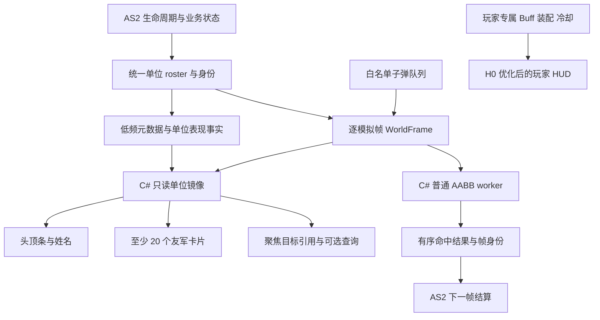

# 玩家 HUD、单位血条、友军与碰撞统一迁移方案

**文档角色**：玩家 HUD 性能优化、单位头顶显示、至少 20 个友军头像与血量、普通 AABB 碰撞迁移的统一路线与验收合同。沿用原单位镜像 ADR 路径；本文件是四项工作的共享架构与阶段依赖真源，迁移台账只记录范围和进度。

**状态**：`PROPOSED / ROUTE_FROZEN / NOT_IMPLEMENTED / P0_EVIDENCE_PENDING`。2026-10-26 本次更新只整理方案；现有玩家 HUD 已实现，新单位镜像、小队显示与碰撞接管尚未实现。`NOT_IMPLEMENTED` 指新增路线，不指已有 HUD。

**最后核对代码基线**：commit `c2664be316fda92c8e2d98149ff5eca790cdc0e6`（2026-10-26 核对当前本机 main）。本轮核查 HUD producer/consumer、上方血条、头像缓存、单位信息更新、BQP、XMLSocket 与共享合成入口。工作区存在其他并发修改，本方案不以未提交 asLoader 或其他资产作为冻结可执行基线；实际施工先冻结隔离源与产物身份。

**证据口径**：§2 为当前源码事实；§3–§13 为目标合同；§14 为施工与依赖；§15 为可执行的测量方法、初始工程预算与退出门。预算尚不是已取得的性能成绩。历史测量保留原负载、产物和证据边界，不能代签本路线。

`ROUTE_FROZEN` 表示本次供评审的方案已固定，不代表代码施工、碰撞权威切换或正式 runtime 发布。实际施工授权与 `compiled → candidate_built → candidate_executed → e2e_verified → promoted → standard_entry_verified` 分别记录。

## 0. 一页结论

### 0.1 统一范围与交付方式

四项工作共用单位身份、生命周期和世界状态来源，各消费者保留独立的更新频率、失效范围与验收结果。H0 先减少现有 HUD 的重复投影和绘制；P0 建立公共单位镜像；P1 同时容纳头顶显示和友军卡片；P3/P4 在同一底座上对照、接管普通 AABB 几何判定。血条与小队显示可以先交付，碰撞未通过不会让已验证的显示收益退回。

| 工作 | 当前状态 | 本轮规划交付 |
|---|---|---|
| 玩家 HUD 性能 H0 | 原生玩家 HUD、Buff 详情、最多 4 个聚焦目标已在主线 | 减少 Buff 重复编码/投影、无关重绘、首次头像处理及 UI 队列积压 |
| 单位头顶显示 P1-HEAD | `InformationComponentUpdater` / `BloodBarEffectHandler` 仍操作 Flash 信息 MovieClip | 迁移姓名及基础血/盾/韧性表现，撤下对应 Flash 显示更新 |
| 友军小队显示 P1-ALLY | 尚无覆盖本需求的统一常驻 20 人投影 | 同时表示至少 5 佣兵、5 战宠及保护 NPC，总数至少 20；使用同一单位镜像 |
| 碰撞 P0-COLLISION / P3 / P4 | 生产几何检测与结算仍在 AS2 BQP | 首批普通 AABB 几何在 C#，固定下一帧由 AS2 结算；复杂弹及地图另分域 |



该图表示目标依赖，不表示当前已经存在 WorldFrame/worker。共享底座不等于所有状态塞进一份大 JSON，也不要求所有消费者等待同一阶段完成。

### 0.2 量纲与范围

| 场景 | 全部单位数 含玩家 | 常驻友军卡片 | 普通逻辑弹 | 用途 |
|---|---:|---:|---:|---|
| 最低友军承诺 | 至少 21 | 20 | 0 / 50 | 5 佣兵 + 5 战宠 + 10 保护或其他友军；布局和身份完整 |
| 常态战斗 | 30 | 20 | 50 | 20 友军 + 玩家 + 9 敌方；常规体验门 |
| 目标大场面 | 50 | 20 | 100 | 主性能与碰撞阶段门 |
| 扩展压力 | 80 | 32 | 200 | 有界退化、队列和增长曲线；首版性能承诺以目标大场面为准 |

“20”是同时可表示的最低产品要求，不是后台只有 20 条数据、靠滚动才看到剩余单位。保护 NPC 不得因佣兵/战宠占满而静默丢失。超过首版容量的明确呈现方式在 P1-ALLY 布局小样裁定，不能用碰撞实体截断满足 UI 上限。

普通逻辑弹数量、联弹组数、联弹子单元数、射线实例/目标数分别统计。现役原生视觉容量不等于几何检测已迁移，也不等于碰撞阶段可以直接承诺同样数量。

### 0.3 成功判据

净收益以删除的 AS2 显示更新、排序、候选扫描及碰撞工作，扣除新增世界帧构建/编码、回包解析、必要 fallback 和 Host 工作后衡量。公共底座只计一次，不能分别在血条、友军和碰撞项目中重复认领。

H0 可独立取得现有功能的成本下降；P0 单独运行主要证明开销上限与正确性；P1 要证明旧 Flash 显示更新确实退出；P4 要证明白名单弹退出本地几何热路且整局帧时间净改善。源码成立、夹具通过、候选执行、真实战斗与正式发布分别出结论。

### 0.4 推荐阅读顺序

排期与验收阅读 §14、§15；实现公共数据面阅读 §7、§8、§9；碰撞时序与回退阅读 §6、§10、§13；尚未冻结的实现选择见 §16。原 2026-08-09 的 P0–P6 阶段身份保留，H0 为现有玩家 HUD 的独立优化阶段，P1-HEAD/P1-ALLY 为 P1 子阶段。

---

## 1. 与既有文档的关系

### 1.1 继承而不复制的现役不变量

[子弹命中-伤害双管线拆分 · 架构设计（2026-06-22）](子弹命中-伤害双管线拆分-架构设计-2026-06-22.md) 是阶段 4 的前置 ADR，也是以下已验证不变量的来源；当前实现事实仍以源码与 canonical docs 为准：

- 命中判定与伤害结算的 clean / dirty 边界；
- AABB 命中倍率恒为 `1`、polygon 使用真实 overlapRatio、ray 使用衰减的三态差异；
- 同一子弹的命中顺序、霰弹值影子窗口与 `additionalEffectDamage` 累积约束；
- 消弹 token、暂停、穿透、销毁优先级和同步 `settleHit` 语义；
- 复杂射线、多边形与现役 AS2 结算管线的行为红线。

本文不重复定义这些规则，也不因 CSharp 计算更“精确”而静默改变旧产品语义。

### 1.2 对既有“阶段 4”的提案内新增边界

本文对旧 ADR 中尚未闭合的 CSharp 碰撞阶段提出并在本提案内冻结：

1. `[产品输入已冻结]` 固定 `n` 帧几何检测、`n+1` 帧 AS2 提交可以成为新战斗时序契约。
2. `[产品输入已冻结]` 允许弹体在视觉上过冲一帧；命中特效使用冻结的 `n` 帧命中点。
3. `[产品输入已冻结]` Guardian Launcher / CSharp 是强制运行时，不支持脱离 Launcher 的独立 Flash 产品形态。
4. `[提案内冻结]` CSharp 只产出几何事实或候选；伤害、闪避、护盾、RNG、死亡和事件仍由 AS2 提交。
5. `[产品输入已冻结]` CSharp 在目标量纲下优先暴力计算；禁止为了复刻 AS2 优化结构而增加 AVM1 整理税。
6. `[提案内冻结]` Shadow 只是限时验证工具，不能成为正式环境的常驻双算。
7. `[提案内冻结]` late / duplicate / cross-epoch / wrong-generation 结果绝不补应用。

进入 `ROUTE_ACCEPTED / P0_AUTHORIZED` 后，CSharp 阶段 4 的跨进程路线以本文为该提案的唯一 source of truth；旧 ADR 只保留伤害/顺序不变量和本提案摘要。在接受之前，本文不覆盖现役实现或旧 ADR，只冻结评审对象。

### 1.3 与 UI 迁移文档的边界

本文同时规划固定屏幕 HUD/友军卡和跟随 Flash 世界坐标的 CSharp native world overlay，优先复用现役共享合成，不套用 [AS2 UI → Web Panel 迁移护栏](../agentsDoc/as2-web-panel-migration.md) 的领域事务模板。文中的服务器端是本机 Launcher/CSharp Host；公网联机服务器和远端网络延迟不在本轮范围。

---

## 2. 当前主线的地基与缺口

### 2.1 玩家 HUD 的现役数据与绘制

| 路径 | 当前源码事实 | 迁移方案中的处理 |
|---|---|---|
| [PlayerHudService](../scripts/类定义/org/flashNight/arki/hud/PlayerHudService.as) | 每帧采样；按组比较变化；约两秒 full；变化组经 LiteJSON/Base64 放入 `pi`；装配一般每三帧读取 | H0 保留生命周期与强制校准，减少重复投影；WorldFrame 另用扁平 lane，不复制整份玩家 HUD |
| [PlayerHudBuffProjection](../scripts/类定义/org/flashNight/arki/hud/PlayerHudBuffProjection.as) | 详情启用后持续读取 activation/mods；计时变化使整组连同 info 重发；每 Buff 8 条、每快照 64 条 mods 是容量保护 | 静态说明与动态状态分离；动态数值仍从真实效果读取，不能因缓存隐藏变化 |
| [PlayerHudState](../launcher/src/Guardian/Hud/PlayerInfo/PlayerHudState.cs) 与 [BuffCard](../launcher/src/Guardian/Hud/PlayerInfo/PlayerHudBuffCard.cs) | 未传入的组复用 typed 对象，但每份新 Snapshot 都重新 Project BuffCards | Buff 数据未变则复用展示卡；按受影响组通知消费者 |
| [PlayerHudController](../launcher/src/Guardian/Hud/PlayerInfo/PlayerHudController.cs) | 队列最多 64 个编码包；Drain 逐包解析与采用，满时清队并请求同步 | 上限不能代替帧内工作预算；状态可以安全合并，动作结果和事务不可丢弃 |
| [PlayerHudRuntime](../launcher/src/Guardian/Hud/PlayerInfo/PlayerHudRuntime.cs) 与 [NativeHudOverlay](../launcher/src/Guardian/NativeHudOverlay.cs) | Buff、聚焦血条、提示共用上方 surface；只有共享主 HUD 启用了局部重绘；提交约 33 ms 合并 | H0/P1 分别治理组件失效与实际上传面积；局部绘制不自动等于局部上传 |
| [FocusTargetHudService](../scripts/类定义/org/flashNight/arki/hud/FocusTargetHudService.as) 与 [FocusTargetWidget](../launcher/src/Guardian/Hud/PlayerInfo/PlayerHudFocusTargetWidget.cs) | protect/boss/combat 最多 4 行；Host parser 与布局也限制 4；包含头像、连击与受击/回血/低血动效 | 保留聚焦角色与优先级；20 人友军另建消费者，不把 4 改成 20 充当完整方案 |

### 2.2 世界单位与碰撞仍在 AS2

[InformationComponentUpdater](../scripts/类定义/org/flashNight/arki/unit/UnitComponent/Updater/InformationComponentUpdater.as) 仍更新 `新版人物文字信息`、血/盾/韧性宽度与残余/渐隐，并发布 `HPChanged`；[BloodBarEffectHandler](../scripts/类定义/org/flashNight/arki/component/Effect/BloodBarEffectHandler.as) 仍触发血条时间线、颜色和受击显示。P1 必须区分这些显示写与领域事件，不能整类删除后期待无副作用。

[BulletQueueProcessor](../scripts/类定义/org/flashNight/arki/bullet/BulletComponent/Queue/BulletQueueProcessor.as) 仍进行阵营候选、Z 粗判、cached AABB、联弹多边形及命中顺序处理，`settleHit` 仍在 AS2。当前 [BulletVisualFrame](../launcher/src/Guardian/WorldCompositor/BulletVisualFrame.cs)、[BulletVisualProbe](../scripts/类定义/org/flashNight/arki/render/BulletVisualProbe.as) 与 [ChainVisualBridge](../scripts/类定义/org/flashNight/arki/render/ChainVisualBridge.as) 服务原生表现，不能直接作为几何结算 authority。

[TargetCacheUpdater](../scripts/类定义/org/flashNight/arki/unit/UnitComponent/Targetcache/TargetCacheUpdater.as) 与 [SortedUnitCache](../scripts/类定义/org/flashNight/arki/unit/UnitComponent/Targetcache/SortedUnitCache.as) 仍服务多个同步消费者。WorldFrame 从生命周期维护的扁平 roster 导出，不主动调用 acquire/cache 重排以“顺手取得”单位列表。哪些旧缓存可以退役，由剩余消费者清单决定。

### 2.3 现有合成器与头像能力

[WorldCompositorController](../launcher/src/Guardian/WorldCompositor/WorldCompositorController.cs) 已有共享 HUD raster 呈现；[WorldRasterPresentation](../launcher/src/Guardian/WorldCompositor/WorldRasterPresentation.cs) 目前只允许层号 0–4，分别由伤害数字、资源、底部、Buff 和主 HUD 使用。不能假定还有第六个空闲槽，不能为每个友军新增 HWND、timer 或 native layer。

[LootIconCatalog](../launcher/src/Guardian/Hud/Loot/LootIconCatalog.cs) 使用有界 24 MiB LRU 和 64×64 缩略图；固定头像首次 miss 会同步栅格化 SVG。纸娃娃由 [DollPortraitBakeService](../launcher/src/Guardian/Hud/Loot/DollPortraitBakeService.cs) 单键去重并异步请求生成；现有最多 64 个在飞请求只是保护上限，不是 20 张首次同时准备的调度策略。

P1 复用这些资源所有权与共享合成入口。2026-08 路线中“优先新增 layered-window world overlay”的物理选择在本次更新为共享合成优先；最终 surface/上传实现由 P1 渲染小样按像素搬运成本裁定。已有 HitNumber reducer 保持唯一。

### 2.4 XMLSocket 与 worker 接入

[XmlSocketServer](../launcher/src/Bus/XmlSocketServer.cs) 仍在读循环按 NUL 分包并同步分派；[FrameTask](../launcher/src/Tasks/FrameTask.cs) 的 F 通道已处理 camera、伤害数字、普通弹/联弹/射线/光等表现。新的碰撞计算不能直接塞入该分派栈，也不能挂在 UI Paint/Timer 上。

新增 world lane 复用现有本机连接及其所有权检查，独立版本、大小上限和 mailbox；读循环只做有界接收/投递，worker 解析计算。逻辑 lane 与时效隔离不要求新 socket。完整协议在 P0 冻结，届时检查输入、SFX、控制消息的尾延迟。

### 2.5 历史性能证据的用途

[10 月 10 日 HUD/Buff 对照](AS2界面快照与Buff调度优化验证-2026-10-10.md) 的 2.432 ms HUD 平均采样来自旧产物、暂停、无 Buff 和空槽位，不能代替当前丰富 HUD 战斗基线。[共享 HUD 成本记录](shared-hud-render-cost-2026-10-10.md) 证明受控呈现中局部绘制和缓冲复用有收益，但当时已明确提交仍搬运完整 raster。

当前 [HUD 体验增量](玩家HUD交互与动效优化-2026-10-23.md) 已包含多目标、头像、连击与腕刃详情。H0/P0 必须对该主线重新测量；当前文档更新不宣称任何新的帧时间、碰撞等价或 20 人运行结果。

---

## 3. 架构原则

### 原则 1 · AVM1 税最小化

每增加一个帧级字段、dirty 检查、容器、排序或第二次遍历，都必须能指向一个将被删除的 AS2 热循环/显示成本，或像 20 人友军卡这样的已明确需求及独立增量预算。只因“CSharp 顺手可用”而扩充 WorldFrame，不构成收益理由。

### 原则 2 · CSharp 可以笨，但边界必须确定

首版允许 `O(B×N)` AABB 和 `O(A×N)` AI 摘要。CSharp 的简单实现必须保持固定迭代顺序、稳定 tie-break、版本化数值语义和有界内存；“暴力”不等于无序或无界。

### 原则 3 · 一份世界事实，多种消费时效

- collision：exact `frameSeq`，固定 `n+1` deadline，不允许 latest-wins。
- bullet threat：随 collision frame 产出，结果年龄上限为 1 帧，不进入四帧 AI advisory 节拍。
- AI：四帧节拍的 advisory `SenseFrame`，允许受控陈旧，不允许晚到覆盖玩家命令。
- overlay：完整或已合并的状态可 latest-wins；身份/元数据和必要事件先有序采用，再合并视觉失效，不直接丢未经合并的增量。
- telemetry/debug：可采样、可降级、不得反压 collision。

### 原则 4 · AS2 仍是业务提交权威

CSharp 返回 `HitIntent`、`SenseFrame` 或 `BoundsCorrectionIntent`；AS2 在显式 phase 中复核代际和业务状态后提交。CSharp 不直接写 HP、护盾、库存、掉落、仇恨、死亡或事件总线。

### 原则 5 · 正式态只保留一个计算权威

Shadow 可以短期开启；正式 steady-state 中，同一弹体/查询域不得同时由 AS2 和 CSharp 全量计算。fallback 是 deadline miss 时的冷路径或场景边界切换，不是每帧热备。

### 原则 6 · 本机 Host 仍需时序身份

Launcher 是强制运行时，因此不需要按不可信公网服务器设计认证、分布式共识或持久重试；但 socket、线程、暂停、重连、换图和对象池复用仍会产生 stale result。batch key `{streamEpoch, sceneEpoch, frameSeq}` 与 entity key `{handle, generation}` 仍是硬约束。

---

## 4. 目标边界与非目标

### 4.1 本路线目标

- 优化现役玩家 HUD；一份单位镜像服务头顶条、至少 20 个友军头像血量及现役聚焦目标，并扩展白名单子弹用于普通 AABB 碰撞。AI 粗查询、bullet threat、雷达按各阶段单独启用。
- 将人物姓名、称号、血条及已有盾/韧性表现从 Flash 显示树垂直切到 CSharp；先保持现役语义和特殊单位例外。
- 将普通 AABB 弹的候选枚举和几何命中移到 CSharp，AS2 保留结算。
- 保持 AI 调用点同步，改为读取已完成的四帧 `SenseFrame`。
- 建立可量测、可熔断、可按弹种/消费者切换的分期入口。

### 4.2 明确非目标

- 不迁完整伤害、Buff、RNG、死亡、掉落与事件状态机。
- 不在首期迁完整 AI 行为树、寻路、LOS 或玩家命令。
- 不在首期迁 Flash `collisionLayer.hitTest`、区域 hitTest、拾取/交互事务。
- 不要求人物文字与 Flash 设备字体、GlowFilter、hardlight/screen 做像素等价。
- 不以独立 Flash 运行、物理双屏或混合 DPI 作为首期发布门；必须保留未来扩展空间。
- 不因少量射线/多边形尖峰污染普通 AABB v1 协议。

---

## 5. 权威矩阵

| 领域 | 现役/切换前权威 | 目标态权威 | CSharp 输出 | AS2 提交责任 |
|---|---|---|---|---|
| 实体出生/死亡/阵营/代际 | AS2 | AS2 | 镜像状态 | 分配 handle/generation、换图清空 |
| 单位/子弹动态事实 | AS2 | AS2 producer | WorldFrame 镜像 | 产生一次扁平帧 |
| 玩家 HUD 与 Buff 详情 | AS2 事实 + 现役 CSharp 显示 | 原权威不变 | 分组状态、只读投影与绘制 | 保留 cooldown/Buff/装备业务，只优化采集和传输 |
| 友军成员/头像/血量 | AS2 佣兵/宠物/关卡绑定与单位状态 | AS2 事实 + CSharp 显示 | 共用镜像的 20 人卡片 | 成员和外观 revision、生命周期；不新建第二套单位 |
| 人物文字/头顶条绘制 | Flash | CSharp | native world overlay | 只发语义状态与锚点；停旧显示树 |
| 普通 AABB 几何命中 | AS2 | CSharp（白名单） | ordered HitIntent | `n+1` 复核并结算 |
| 动态消弹/反弹前置裁决 | AS2 BQP stage 1 | AS2（v1） | 无 | WorldFrame freeze 前处理；VANISH/REMOVE 不导出，BOUNCE 按现役语义跳过当帧单位碰撞 |
| 射线/多边形/特殊弹 | AS2 | AS2，按 profile 再议 | 可选 shadow | 保持旧顺序与特效 |
| 闪避/伤害/护盾/RNG | AS2 | AS2 | 无 | 完整业务权威 |
| hit/kill/death 等事件 | AS2 | AS2 | 无 | 保持事件顺序与副作用 |
| AI nearest/range/count | AS2 TargetCache | CSharp advisory | SenseFrame shortlist/摘要 | live 复核、评分、选靶、玩家命令优先 |
| bulletThreat | AS2 扫描尾部 | CSharp（remote-primary）+ AS2（legacy） | 每碰撞帧 ThreatFrame：count/minETA/direction | 下一帧合并/写入 AI 可读快照，最大年龄 1 帧；legacy 未迁前保留本地贡献 |
| 相机实际 transform | AS2 | AS2 | 可选统计建议 | snap/切镜/缩放仍由 AS2 |
| 雷达/屏外指示 | 无或局部 | CSharp | 视觉投影 | 不产生玩法副作用 |
| xmin/xmax/ymin/ymax 越界 | AS2/缺口 | CSharp 建议 + AS2 提交 | BoundsCorrectionIntent | 复核移动 revision/传送并走 Mover |
| 地图像素碰撞/导航 | AS2 | AS2，后续独立 ADR | 无 | 继续使用现役地图语义 |
| 治疗/拾取/库存事务 | AS2 | AS2 | 最多候选建议 | 即时重验并原子提交 |

---

## 6. 固定一帧碰撞时序

### 6.1 目标 phase

```text
frame n pre-simulation
    drain exact result(n-1) 或执行同一 frozen snapshot 的 fallback
    标记 n-1 committed

frame n simulation
    unit/task update
    bullet preCheck / AABB update / external-simple queue enqueue

frame n collision-submit
    执行动态消弹/反弹 prepass
    BOUNCE/VANISH/REMOVE 在 AS2 各自完成一次 movement/收尾
    只保留 NONE 子弹进入 WorldFrame
    单次扫描 unit roster + external-simple bullet queue
    构建 immutable WorldFrame(n)
    投递 CSharp collision worker
    migrated bullet 执行既有 movement / 非碰撞生命周期

CSharp worker
    解析 WorldFrame(n)
    暴力 AABB / 固定排序
    返回 HitIntentBatch(n, applyAt=n+1)

frame n+1 pre-simulation
    只消费 exact n，随后才允许单位 AI 与 bullet preCheck
```

`pre-simulation commit` 必须是显式 phase，不依赖 EventBus 当前倒序订阅的偶然顺序。

### 6.2 已冻结的跨帧语义

- `n` 帧几何为命中事实；`n+1` 使用 AS2 当时活状态进行伤害、护盾、闪避和事件结算。
- `n+1` 必须重验 scene/handle/generation、alive/HP、`防止无限飞`、自碰撞和 batch disposition；不因目标在 `n` 后正常移动而推翻已经成立的几何命中。
- 允许弹体多飞一帧；命中特效使用 `n` 帧冻结命中点。
- 伤害数字跟随命中点还是 `n+1` 目标位置，由表现阶段单独冻结；不得影响命中权威。
- 结果晚于 `n+1 pre-simulation` 不得补伤害。
- 一个完整 batch key `{streamEpoch, sceneEpoch, frameSeq}` 只能由 remote 或 fallback 之一提交；v1 不允许按子弹或 contact 混合两种来源。

### 6.3 生命周期裁决

1. `streamEpoch` 或 `sceneEpoch` 不符：整批丢弃，不进入 disposition ledger。
2. batch 不完整、metadata/profile revision 不符、输入计数/`inputIntegrityToken` 不符或出现未知 handle/profile：整批判无效，对同一 frozen snapshot 走 fallback；禁止猜默认 profile 或部分采用。
3. target generation 不符：对应候选丢弃，绝不重定向到复用 handle 的新实体；bullet 必须命中本 batch 的 detached pending settlement record，记录缺失视为 batch fault。
4. 同 generation 但目标在 `n+1` 已死亡：跳过该候选，继续该子弹的后续有序候选。
5. 子弹生成后射手死亡：子弹仍有效，使用当前 `settlementRevision` 对应的 context。初始 context 在生成期冻结；若子弹随后发生合法 BOUNCE，必须在旧 pending batch 已 disposition 后，原子替换 owner handle/generation、shooter reference、阵营与其他归属字段，并推进 `settlementRevision`，下一次 WorldFrame/`inputIntegrityToken` 使用新 revision。
6. **每一个进入 remote-primary WorldFrame 的 bullet** 都必须在 AS2 建立 detached pending settlement record，直到整个 batch 已作出 remote/fallback disposition；不能等 CSharp 报告命中后才补建。该记录持有 bullet/owner generation、结算上下文与生命周期意图，未释放前对应 handle/generation 不得复用。
7. bullet MovieClip 在 `n` 后因地图/范围/表现销毁，不会取消其 pending record；若 remote/fallback 在该 frozen snapshot 得出命中，仍在 `n+1` 依记录结算。
8. AS2 已 fallback：之后到达的同 batch key CSharp 结果无条件丢弃。

第 6 条的粒度固定为：每个 bullet generation 一份 settlement context，每个 pending batch ledger 只引用它。batch disposition 后释放该 batch 引用；只有 bullet 已进入本地终止态且 pending 引用归零，才释放 context 并允许复用 handle/generation。在“`n+1` 先提交、再运行本帧 bullet preCheck/导出”的时序下，同一 bullet 正常最多只有一个未决 batch；不得据此实现无界 seq-range 或长期累计 30 份 batch record。

### 6.4 batch 完整性与单一 disposition

每个输入 batch 至少携带：

```text
batch key = streamEpoch + sceneEpoch + frameSeq
batchId（与 batch key 一一对应的 opaque correlation id）
expectedUnitCount / expectedBulletCount
inputIntegrityToken（inputHash 或 manifestHash）
metaRevision / fullSyncRevision
collisionComparatorRevision
collisionNumericRevision
batchComplete
```

CSharp 结果必须回显 batch key、`batchId`、`inputIntegrityToken`、metadata/full-sync revision、comparator/numeric revision、处理计数与 `status=complete`。`inputIntegrityToken` 至少覆盖有序 unit/bullet roster、每个记录的 kind/handle/generation、bullet settlement revision、counts、cancel disposition 与相关 revision。`batchId` 不能替代三元 batch key 授权提交；两者映射冲突、scene 内 `frameSeq` 回退/重复/静默 wrap，或 `applyAtFrameSeq != frameSeq + 1` 都是整批 fault。v1 只接受**完整批次 remote commit**：partial、truncated、overloaded、fault、revision mismatch、count/token mismatch 都使整批 fallback；不做 per-bullet remote/local 混合，也不在部分 contact 已提交后重试整批。零命中结果只有在完整性字段证明所有 expected bullets 已处理时才是合法空结果。

### 6.5 结果顺序

结果粒度固定为“子弹 × 有序候选列表”，禁止按目标聚合。P0-COLLISION 必须从现役 BQP/SortedUnitCache 的真实选中顺序冻结 `collisionComparatorRevision`，包括边界相等、同 left 值、同进入时间和稳定 tie-break；**不得把 CSharp roster 遍历顺序当作碰撞语义**。结果至少绑定：

```text
queue/source ordinal
    → bullet ordinal
    → frozen legacy comparator
    → candidate/contact ordinal
```

第一批只迁不穿透的普通弹，仍必须返回有序候选而不是仅返回首个目标：`n+1` 提交时前一候选可能已经死亡或失效，AS2 需要继续扫描后续候选。

### 6.6 数值等价合同

v1 使用独立 `collisionNumericRevision`，并将它与 `collisionComparatorRevision` 一起写入输入和结果。数值等价以现役 BQP 普通 AABB 热路径为 oracle，不以抽象几何库或“CSharp 更精确”为 oracle：

- AABB/Z 分离必须逐比较复刻现役 `<`、`<=`、`>=` 组合，不引入 epsilon、`float` 降精度或隐式量化。普通 BQP 热路径在左右边缘相等时存在方向性：`unitRight == bulletLeft` 被内联 `bulletLeft >= unitRight` 排除；`unitLeft == bulletRight` 仍进入候选窗口，且不会再被 X 条件排除，Y/Z 合法时可命中。该不对称是 v1 parity 合同，不能笼统改写成“所有边缘接触均不命中”；是否修正另立 gameplay/balance 裁决（[BulletQueueProcessor.as](../scripts/类定义/org/flashNight/arki/bullet/BulletComponent/Queue/BulletQueueProcessor.as)；[L3062-L3108](../scripts/类定义/org/flashNight/arki/bullet/BulletComponent/Queue/BulletQueueProcessor.as)）。
- AABB `dmgMult` 恒为 `1`。
- AABB 命中点必须复刻 AVM1 位运算：先以 `Number` 求两侧重叠边界之和，再按 ECMAScript `ToInt32` 语义转换该和，最后执行有符号算术 `>> 1`；不得用 CSharp `double / 2` 代替（[BulletQueueProcessor.as](../scripts/类定义/org/flashNight/arki/bullet/BulletComponent/Queue/BulletQueueProcessor.as)）。
- 输入使用 AS2 `Number` / CSharp `double` 可往返的有限值；`NaN`、`±Infinity`、缺失值、超长/不可解析 token 或 codec 声明范围外的值使整批无效，禁止默认为零。`-0` 在线路上规范化为 `0`。
- P0-COLLISION golden 至少覆盖小数与负坐标、奇偶和、四向边界相等、Z 临界值、`ToInt32` wrap 边界，以及 contact point 的逐值 parity。

---

## 7. 数据面概念合同

> 本节冻结职责与最小语义，不冻结 wire prefix、分隔符、具体类型宽度或类名。对应 P0-COMMON / P0-COLLISION readiness 量测后另立协议施工文档。

### 7.0 四项工作共用的数据分层

下列名称是职责名，未固定 wire prefix、字段位宽或具体类名。数据自 AS2 单向投影，显示不触发角色重建、Buff 注入/移除、回调、物品消费或存档写入。

| 层 | 最小内容 | 频率与采用规则 | 消费者 |
|---|---|---|---|
| EntityMetaDelta | handle/generation、类型、所属关系、名字、头像键或外观 tuple、外观 revision、角色标签 | spawn/despawn/真实内容变化；revision 连续且可 full resync；元数据不随掉血重发 | 头顶、友军、聚焦、碰撞类型 |
| WorldFrame | 单位显示坐标、groundY、锚点/visual transform、cached AABB、alive/collidable/faction 等资格；需要时加入白名单子弹 | 每模拟帧；collision 使用 exact frame，overlay 可取最新；一份不可变输入，多消费者引用 | 头顶位置、碰撞、可选查询 |
| UnitPresentation | 当前/最大 HP、盾/韧性展示事实、受击显现等有限事件 | 初始方案每 3 模拟帧约 10 Hz；死亡/退场及关键显隐及时发送；按 source frame 推进表现，不推进 gameplay | 头顶、20 人卡片、聚焦 |
| 玩家专属投影 | 玩家装配、技能/药剂、弹药、冷却、Buff 元数据与动态详情 | 保留各领域实际权威与 H0 分组更新；不广播给每个单位 | 玩家 HUD |
| HitIntentBatch | batch/实体代际、ordered candidates、命中点、完整性与 apply frame | exact n，在 n+1 pre-simulation 采用；不可 latest-wins | AS2 结算 |

UnitPresentation 的 10 Hz 是本次初始显示方案，取代旧提案的“四帧表现槽”；AI SenseFrame 仍是四帧节拍，玩法计时和 Buff 更新节拍不变。暂停时 source frame 不推进。关键状态的立即投影复用现有生命周期/伤害事实；不为显示额外执行一次领域更新。

H0 不强制等待 WorldFrame。P0-COMMON 上线后，玩家 actor、聚焦目标和友军卡使用同一 entity key 关联；玩家 epoch 与 scene/stream epoch 有明确绑定。P1 接续时逐项撤下重复单位元数据和 HP producer，不能长期并存“新镜像 + 旧 focus rich DTO + 独立小队全量快照”三套来源。

元数据 ACK 只确认身份和字段已采用，不等待头像文件、纸娃娃烘焙或 UI 绘制。视觉资源失败不撤销已闭合的碰撞几何 readiness；显示与碰撞分别记录能力就绪，头像用占位重试。

固定屏幕友军卡不直接消费位置变化通知；world anchor 变化只使头顶组件失效。相同单位出现于聚焦、头顶和小队三个位置，可以有三种呈现，但仅有一份身份/HP 事实。

友军成员来自真实佣兵、战宠及关卡保护绑定，生命周期维护集合；C# 可以筛选/排序/布局，不从名字、头像或阵营字符串猜测保护目标。名单更新后保留同代际的槽位稳定性，死亡、复活、换人和换图均有明确转移。

---

### 7.1 身份头

所有计算帧和结果至少携带：

```text
protocolVersion
streamEpoch
sceneEpoch
frameSeq
sourceFrameSeq / applyAtFrameSeq
metaRevision / fullSyncRevision
```

collision input/result 还必须携带 `collisionComparatorRevision / collisionNumericRevision`；Sense/Threat/overlay 只携其消费者实际需要的 plan/presentation revision，不为统一头部强塞碰撞字段。

实体键使用 `{handle, generation}`；若单位与子弹最终采用分池编号，则 wire key 必须提升为 `{kind, handle, generation}`，不能依赖记录上下文猜 kind。`_name` 只可作诊断字段。`DepthManager.entityID` 会回收，不能单独承担跨帧身份。handle 只在 spawn 分配，generation 在每次池复用或新逻辑生命期推进；同一 stream 内不得静默 wrap。spawn metadata 必须早于实体首次进入 WorldFrame，释放与复用还必须满足 §6.3 的 pending record barrier。

### 7.2 EntityMetaDelta

自然生命周期事件，只在 spawn/change/despawn 发生：

- handle / generation / kind / faction / capability flags；
- name / title / level / style token；
- portrait key / appearance tuple / appearance revision、友军类型/所属关系及保护目标标签；
- head-anchor profile：局部锚点、方向抵消规则与基础显示缩放；其 revision 独立于 collider；
- collider profile / local bounds / geometry revision；
- simple bullet 的静态形状和允许的运动类别。

每次变化推进单调 `metaRevision`；场景启动与重连发送带 `fullSyncRevision` 的完整 catalog。CSharp 必须先顺序应用到 WorldFrame 声明的 revision，再返回 `laneReady(protocolVersion, streamEpoch, sceneEpoch, fullSyncRevision, metaRevision, capabilities)`。未知 handle/profile、缺失 revision 或 WorldFrame 超前于 metadata 都使该 batch 无效并触发 fallback，不能猜默认值。

同一连接内检测到 revision gap、未知 profile/handle、worker state 丢失或冲突重复 delta 时，不能永久停在 fallback 等待下一次重连。CSharp 必须返回 `metaResyncRequired(streamEpoch, sceneEpoch, appliedMetaRevision, observedMetaRevision, reason)` 并立即撤销 `laneReady`；AS2 对当前 pending batch 使用同一 frozen snapshot fallback，停止新的 remote commit，推进 `fullSyncRevision` 并发送带 expected meta count、`catalogIntegrityToken` 与 `catalogSnapshotMetaRevision` watermark 的完整 catalog。full catalog 构建期间产生的新 delta 进入有界队列，在 catalog 原子替换后从 watermark+1 连续应用；队列溢出或再次出现 gap 就重启 full sync。CSharp 只有在完整 catalog 原子替换且追平声明的 ready revision 后，才可返回精确匹配的 `laneReady`。恢复前所有 gameplay result 都拒绝；完全相同的旧 revision 可幂等丢弃，同 revision 内容冲突、跳号或 partial full sync 一律 fault。

正常流中 CSharp 以 `metaAckRevision` 回报已原子应用的 watermark；AS2 只需在有界窗口内保留未确认 delta，并始终保有重新生成完整 catalog 的能力。ACK 停滞或 delta window 溢出时不得无界留存或猜测丢包，直接撤销 readiness 并合并为一次 full resync。

`catalogIntegrityToken` 属于 P0-COMMON，只覆盖 catalog/fullSync revision、expected meta count、有序记录内容与完整结束标记；§6.4 的 `inputIntegrityToken` 属于 P0-COLLISION，覆盖 collision batch、bullet settlement/cancel/comparator/numeric 等动态输入。二者不能共用含糊的 `integrityToken` 名称，也不能让 catalog 恢复等待碰撞 token 算法冻结。

`head-anchor profile revision` 与 `collider geometry revision` 不得共用；动态层也必须拆开 live visual transform 与 cached AABB/collision-transform revision。前者服务显示，跟随单位当前视觉位置、朝向与缩放；后者服务 gameplay parity，表示现役 `aabbCollider` 最近一次实际刷新后的冻结几何。静止单位只推进动画、但未触发现役碰撞盒刷新时，head anchor 可以继续随视觉状态更新，cached AABB/collision-transform revision 不得因此推进。高频 collision-transform 属于 WorldFrame，不推进低频 `metaRevision`。

这不是通用逐字段 dirty engine；只使用现有生命周期或明确 setter 能自然给出的变化。

### 7.3 WorldFrame

v1 优先采用每帧自包含的全量动态数值帧：

- camera transform 与 viewport revision；
- unit handle/gen、`displayX=_x`、`displayY=_y`、`groundY=Z轴坐标`、朝向/显示缩放、head-anchor profile/visual-transform revision、gameplay eligibility flags、faction/capability revision，以及 cached dynamic AABB 或 collider profile + collision-transform revision；
- bullet handle/gen、owner handle/gen、`settlementRevision`、`displayX=_x`、`displayY=_y`、`groundY=Z轴坐标`、zRange、gameplay flags、source ordinal；
- 仅 collision/AI/overlay 至少一个消费者需要的动态字段。

上述字段名是语义名，wire grammar 仍由对应 readiness 冻结。三分量不能折叠：`displayX/displayY` 服务单位本体与头顶锚点投影，`groundY` 服务地面平面、纵深、AI 与 Z 粗判；浮空高度由 `groundY - displayY` 派生（[玩家模板迁移.as](../scripts/逻辑/单位函数/单位函数_fs_aka_玩家模板迁移.as)）。只发送 `_x/_y` 会丢失碰撞 Z，只发送 `_x/Z轴坐标` 会使浮空单位的头顶锚点钉在地面。P0-COMMON 必须冻结“直接发送当帧 world-space head anchor”或“profile + 完整 live visual transform”之一；只有 root position 与 profile、却缺方向/缩放/旋转语义，不构成完整 anchor 合同。

位置、碰撞、相机，以及 `alive/collidable/faction/generation/capability` 等 gameplay eligibility 必须每帧或以同帧可见 revision 更新；collision/AI 不得从低频表现槽读取资格。HP/maxHP、盾/韧性等纯表现状态初始每 3 帧采集，死亡/退场和关键显隐及时投影；姓名/称号只走 MetaDelta。需要当前 HP 的 AI predicate 由 AS2 live 复核，不能把表现采样当权威。各消费者按能力订阅字段组：P0-COMMON 的最小显示镜像不用承担尚未启用的 bullet/result/ThreatFrame 构建，碰撞启用时补齐其必要资格与几何字段。

### 7.4 HitIntentBatch

CSharp 返回几何事实，不返回最终伤害：

- source/apply frame；
- batchId、status、expected/processed counts、inputIntegrityToken；
- meta/fullSync/comparator/numeric revision；
- bullet/target handle + generation，以及 bullet `settlementRevision`；
- source/contact ordinal；
- contact point；
- AABB `dmgMult=1` 或明确 geometry kind；
- 可选 TOI/法线只在有已冻结消费者时加入。

### 7.5 SenseFrame

按四帧节拍返回固定词汇表：

- nearest hostile/ally shortlist；
- bounded range count / left-right density；
- camera/radar 可复用的只读统计。

每个 query result 还必须声明 `complete`、`provenTopK` 或 `advisoryOnly`。只有完整有序集，或能证明省略项不可能超过第 K 名的 `provenTopK`，才允许替代 legacy query；否则 AS2 保留本地查询或 fallback。

不支持 AS2 任意 `Function predicate` 跨进程执行；这类 query 长期留 AS2。计划在 spawn/行为参数变化时用稳定 `planId/revision` 更新，不能每次查询建立 RPC 对象。

### 7.6 ThreatFrame

随每个 collision WorldFrame 计算并在下一帧提交，按单位返回 `count/minETA/direction`。它与四帧 `SenseFrame` 分 lane/节拍，采用结果的年龄不得超过 1 帧；结果缺失时保留现役本地值或走该 collision batch 的 fallback，不用更老的 advisory 覆盖。

### 7.7 BoundsCorrectionIntent

只用于安全保护：

- sceneEpoch、entity handle/gen；
- observed frame / movement revision；
- 违反的 xmin/xmax/ymin/ymax；
- 建议恢复位置或 last-known-legal token。

AS2 必须复核实体代际、传送/击飞状态和 movement revision，并通过统一 Mover/位置 setter 应用，禁止 CSharp 直接写 `_x/_y`。

### 7.8 Raw lane envelope 与硬上限

raw lane 是 `\0` 分隔 UTF-8 扁平文本，不是无限长二进制流。每个 `protocolVersion` 必须冻结 `maxMessageBytes`、`maxAssemblyAge`、`maxReadIdle`、`maxUnits`、`maxBullets`、`maxContactsPerBullet`、`maxTotalContacts`、`maxMetaEntries`、`maxFieldCount` 与单字段/数字 token 最大长度；full catalog 可以使用独立但仍有限的 cap。

上限必须在四处执行：AS2 producer 发送前、CSharp 遇到 NUL 前的字节累积阶段、parser 写复用数组前、AS2 result parser 提交前。expected counts 超 cap 本身就是非法 header。未达到 byte cap 但迟迟没有 NUL 的半包，也必须在 `maxAssemblyAge` 或 `maxReadIdle` 到期后清空累积、关闭当前 connection generation 并撤销 readiness；pending collision 仍只在其 `n+1` deadline 走一次 frozen fallback。任何 oversize、assembly timeout、truncated、字段数不符或 contact explosion 只允许关闭当前 connection generation/整批 fault、fallback 并计入 circuit breaker；禁止截断、partial commit、无界扩容或对 gameplay latest-wins。P0-COMMON 冻结全局 byte/assembly/field envelope 与 unit/meta/catalog caps；P0-COLLISION 冻结 bullet request、result/contact caps。

---

## 8. AVM1 友好的 producer 设计

### 8.1 单次扫描

remote-primary 稳态结构目标：

```text
一次 unit roster 线性扫描
+ 一次 external-simple bullet queue 线性扫描
+ 一次 raw frame 编码/发送
+ n+1 一次结果游标解析/提交
```

overlay、AI、collision 不得分别触发第二次 gameworld/TargetCache/BulletQueue 扫描。

### 8.2 禁止项

- 不为导出调用 `TargetCacheManager.acquire*Cache(..., 1)`。
- 不为 CSharp 调用 `sortByLeftBoundary()`。
- 不在热路径 `for-in gameworld`、visitor callback、JSON stringify 或 `LiteJSON`。
- 不逐实体 `new Object/new Array`，不物化 rich DTO。
- 不在 AS2 计算 CSharp 可暴力完成的阵营候选、距离、排序、空间格或 per-entity/加密 hash。只允许两个按域冻结的完整性例外：P0-COMMON 的 `catalogIntegrityToken` 在 catalog 编码中顺带产生；P0-COLLISION 的 `inputIntegrityToken` 在 WorldFrame/collision batch 编码中顺带产生。二者都不得为 token 二次遍历或引入加密热税。
- 不把 full snapshot 先写一份 SoA，再二次遍历序列化，除非 P0-COMMON 证明其净收益。
- 不复制 HitNumber 的 viewport 剔除；同一 WorldFrame 由 CSharp 完成 overlay 投影与裁剪。

### 8.3 roster 与 external-simple queue

- unit roster 由 spawn/death/faction change 生命周期维护，热帧只读复用引用与缓存数值身份。
- bullet capability 冻结三种互斥运行模式：
  - `legacy-only`：只进入 legacy BQP，不进入外部玩法权威；
  - `shadow`：仍由 legacy BQP 唯一结算，只额外导出只读 frozen input/result trace 做比较，不建立 external gameplay authority；
  - `remote-primary`：生成/分类时只进入 external-simple queue，不进入 legacy BQP active queue。
- P0-COLLISION 只验证分类与碰撞扩展，不改变现役入队；P3 使用 `shadow`；只有 P4 gate 通过后才把白名单弹切为 `remote-primary`。
- legacy BQP 继续处理 ray/polygon/cancel/UnitBullet 等例外，保持其现有预取键、排序、扫描和清理优化不受破坏。
- `remote-primary` 只移出“子弹 × 单位”几何检测，不得绕过场上动态出现的全局消弹区。v1 从 BQP 抽取或复用一段共享 AS2 cancel prepass，在 WorldFrame freeze 前处理 external-simple queue（现役前置顺序见 [BulletQueueProcessor.as](../scripts/类定义/org/flashNight/arki/bullet/BulletComponent/Queue/BulletQueueProcessor.as)；[L2867-L2984](../scripts/类定义/org/flashNight/arki/bullet/BulletComponent/Queue/BulletQueueProcessor.as)）：
  - `VANISH/REMOVE`：保留现役 `霰弹值=1`、`STATE_HIT_MAP`、killFlags、恰好一次 movement、地图命中 FX/`击中时触发函数` 与 REMOVE/VANISH 统一终止优先级，不进入本帧 collision batch（[BulletQueueProcessor.as](../scripts/类定义/org/flashNight/arki/bullet/BulletComponent/Queue/BulletQueueProcessor.as)；[L3329-L3370](../scripts/类定义/org/flashNight/arki/bullet/BulletComponent/Queue/BulletQueueProcessor.as)）；
  - `BOUNCE`：执行现役 `handleBounce`，在旧 pending batch 已 disposition 后原子刷新 owner/faction/shooter settlement context 与 `settlementRevision`，再执行恰好一次 movement，并按现役 `continue` 语义跳过当帧单位碰撞（[BulletCancelQueueProcessor.as](../scripts/类定义/org/flashNight/arki/bullet/BulletComponent/Queue/BulletCancelQueueProcessor.as)）；
  - `NONE`：才允许冻结并导出。
- cancel disposition 必须进入 frozen input/`inputIntegrityToken` 和 shadow golden；不能在 `n+1` live world 补判。只有 profile 证明该条件 prepass 本身成为瓶颈，才把 cancel-zone geometry 纳入 P6。
- cancel-zone catalog/SoA 每帧只允许 prepare 一次并同时服务 external 与 legacy 队列。该 prepass 在 `hasCZ=false` 时必须保持 O(1) 快退；有区域时可直接对目标量纲采用条件式 `O(B×C)` 暴力遍历，不能为了复用现役双扫描线而让 external queue 常态排序。区域优先级、重叠区 first-writer/token 语义仍须复刻现役。
- `shadow` 弹仍由现役 BQP stage 1 唯一产生 cancel/bounce 副作用；影子链只读取其 token/disposition 作为 oracle，禁止第二次调用 `handleBounce` 或重复写终止意图。独立 external cancel prepass 只在 remote-primary 切流时成为权威。
- 只有 `NONE` 的 remote-primary bullet 在导出后执行既有一次 movement 和非碰撞 shouldDestroy；BOUNCE/VANISH/REMOVE 已在 prepass 分支各执行一次，禁止漏执行或双执行。每个导出 bullet 的命中结算使用 §6.3 的 detached pending record。

### 8.4 编码策略待量测

AS2 微基准表明裸字符串 `+` 可能比 `Array.join()` 便宜，但完整 WorldFrame 还涉及数字转字符串、数组写入、字符串扩容和 GC。P0-COMMON 必须在真实 50/100 载荷上比较：

1. 分段直接拼接；
2. 复用 flat parts 数组 + 单次 join；
3. 字段裁剪与自然 MetaDelta 后的 full dynamic frame。

未取得真实 build/encode/send p95/p99 前，不冻结二进制、压缩、量化、base64 或通用 delta。

### 8.5 collider profile 机会

普通 bullet 已采用“首次缓存 local bounds，之后按位置偏移”的路径，透明弹为固定 25×25（[AABBCollider.as](../scripts/类定义/org/flashNight/arki/bullet/BulletComponent/Collider/AABBCollider.as)）。单位 `updateFromUnitArea()` 会调用 `unit.area.getRect(_root.gameworld)`（[AABBCollider.as](../scripts/类定义/org/flashNight/arki/bullet/BulletComponent/Collider/AABBCollider.as)），但现役 TargetCache 并非稳态每帧重算该 `getRect`。

现役单位 AABB 是一次 `unit.area.getRect(_root.gameworld)` 的缓存快照，不是当前动画帧几何的持续函数。Mover 的多个实际移动路径会刷新碰撞盒（[Mover.as](../scripts/类定义/org/flashNight/arki/spatial/move/Mover.as)；[L177-L204](../scripts/类定义/org/flashNight/arki/spatial/move/Mover.as)），状态/tick 路径与 TargetCache 重新收集也存在显式刷新；但“静止且只播放动画”不保证刷新。

因此 P0-COLLISION/P3 的 parity 真源必须是当帧已经缓存的 `aabbCollider.left/right/top/bottom`，读取时不得再次调用 `getRect()`。静止动画、静止转向或姿态细节变化若没有触发现役 `updateFromUnitArea()`，CSharp 也必须继续使用旧碰撞盒；不得依据 live visual transform 主动提高精度。

`collider profile + collision-transform snapshot` 只是减少四边传输的候选优化：

- P0-COLLISION baseline：逐帧导出 cached AABB 四边，先证明 collision parity；
- profile 模式：只有在不增加 AS2 `getRect`、姿态判断或第二次扫描的前提下，证明能重建同一 cached AABB，才可进入 remote-primary；
- profile/revision 只在现役碰撞盒刷新点推进，不按动画播放帧加密；
- 真正修复“静止动画使用陈旧 AABB”属于独立 gameplay/balance 裁决，不得夹带进本迁移。

不能为了少数动态碰撞器污染全部单位/子弹记录，也不能为了省四个数值字段改变现役碰撞语义。

---

## 9. CSharp 计算与调度设计

### 9.1 v1 简单实现

- raw ingress 先在字节层执行 prefix/消息长度硬限，再解码小 header；只有 counts/caps 合法才进入 bounded mailbox，完整解析仍在 worker。
- worker 先应用并确认 metadata/fullSync revision，未 `laneReady` 或 revision 不闭合时拒绝 gameplay batch。
- parser 写入双缓冲或复用的 struct arrays。
- 普通 AABB 直接 `B×N`，按 faction/flags 过滤。
- AI 摘要按 `A×N` 暴力扫描，先复刻旧 metric/tie，再单独评估行为升级。
- handle→index 表、结果数组和 overlay surface 必须有界复用。

### 9.2 首期禁止提前引入

- spatial hash / BVH / quadtree / sweep-line；
- SIMD / unsafe / 多 worker job system；
- 通用 ECS、predicate DSL、query planner；
- delta/bitpack/varint/compression；
- 为碰撞另建 shared memory、第二 socket 或新的 native C++ 计算依赖。

现役 native compositor 已是显示底座；P1 若确需调整其层/批次 ABI，按渲染消融与发布范围处理，不等于允许另建碰撞后端。

只有 `parse + O(B×N + A×N)` 在目标负载下成为 deadline 主因，才先优化 parser/复用；仍不满足，再评估最简单的 uniform grid。

### 9.3 mailbox 与优先级

| lane | mailbox/顺序 | 过载策略 |
|---|---|---|
| metadata/fullSync control | 单调 revision；一个 retained full catalog + 有界 delta/ACK watermark | gap/worker reset 立即撤销 laneReady 并请求 full resync；禁止静默丢 delta |
| collision input | 单 worker，最多 active + pending | 拒绝并报告 miss；禁止覆盖 expected seq |
| collision result | exact epoch/seq，小型 expected/future 槽 | 旧、重复、late 立即丢弃 |
| ThreatFrame | 与 collision result 同 batch/seq，最大年龄 1 | 缺失时不得沿用更老 threat advisory |
| AI SenseFrame | latest completed，带 age/plan revision | 可覆盖旧 advisory；不得拖慢 collision |
| overlay | 单 pending UI post，完整/已合并状态 latest-wins | 元数据和必要事件先采用；丢旧绘制请求，保留最新完整状态 |
| telemetry/debug | 有界采样 | 首先降级或关闭 |

### 9.4 World Overlay 与共享合成

逻辑上区分 nameplate、bar、ally cards、damage-number、debug/radar；物理上优先复用当前 WorldCompositor。damage-number 的 C# reducer、聚合/裁剪、reset generation 及固定容量精确账本保持现役单一权威；WorldFrame 不复制它，也不把历史账本放回战斗 paint。

当前 raster 通道仅有五个槽，且局部 CPU 绘制后仍可能复制/上传完整 raster。P1-RENDER 先比较两条有限路径：在可复用的共享层内按受影响区域批量画；确有收益证据时增加专用有界批次或调整层 ABI。比较必须包含实际像素面积、CPU copy、GPU upload/queue、遮挡、DRS 和输入定位，不能只量 Paint。

不预设全视口巨大位图，也不按单位/友军创建 HWND、Timer 或独立提交。原持久 DIB/DC 可复用为必要的 CPU 资源实现，但本次不再把新增 layered-window overlay 冻结为首选产品路径。最终方案和产物依赖在 P1 小样后记录；已有共享合成与 damage-number reducer 不因此重写。

#### 9.4.1 Bar presentation reducer

P1 cutover 后，CSharp 是 residual HP、渐隐、受击显现、轻微抖动与颜色表现的唯一 reducer；AS2 只提供初始每 3 帧的语义快照和带 frame/epoch 的表现事件，不继续计算或传输最终 `_width/_alpha/timeline frame`。现役语义基线包括 HP 变化时重置 actual/residual 起点、残余血条二次缓出、长时间无变化后的渐隐，以及受击时重新显现/播放、颜色反馈和位置抖动（[InformationComponentUpdater.as](../scripts/类定义/org/flashNight/arki/unit/UnitComponent/Updater/InformationComponentUpdater.as)；[Updater 血条逻辑](../scripts/类定义/org/flashNight/arki/unit/UnitComponent/Updater/InformationComponentUpdater.as)；[BloodBarEffectHandler.as](../scripts/类定义/org/flashNight/arki/component/Effect/BloodBarEffectHandler.as)）。

P1 shadow 可同时计算用于限时对账，但只能有一个可见 authority；切流后必须停止 Flash updater/时间线，且禁止从隐藏 MovieClip 反读 width/alpha。若完整复刻成本不成立，只能通过产品裁决降低表现合同，不能永久保留 AS2 width/alpha 状态机。

Bar reducer 只按已接受的 game/presentation frame 推进，不使用独立 wall-clock timer；Flash pause 不得让 residual/fade 私自前进。逻辑年龄由单调 source/presentation `frameSeq` 或显式表现采样序号计算，不按 UI paint/post 次数 `+1`。latest-wins 合并视觉帧时，reducer 必须按 seq delta 确定性追进，或由最新 full presentation snapshot 直接重建；gap 超过冻结上限时 resync/snap，禁止逐个补播无界历史事件。`sceneEpoch` 或 `streamEpoch` 变化立即废弃旧 reducer 状态与旧事件；恢复后的第一份完整 presentation snapshot 按 P1 冻结的初始化策略建立 actual/residual/fade 状态，旧 epoch 事件一律丢弃。重连后选择“完整恢复残血/渐隐状态”或“无动画 snap 到当前玩法事实”由 P1 cutover 前裁决，但不得猜测或沿用旧 stream 状态。

以上时钟约束针对世界头顶条。现役玩家 HUD 中暂停时仍运行的装饰动效保持原合同，不把所有 UI Timer 统一改为 gameplay frame。

首期产品边界：

- 语义/可读性等价，不要求 Flash 字体与 blend mode 像素等价；
- 普通单位允许绘制在 Flash 世界之上；特殊遮挡/特殊血条单位走 allowlist；
- 单屏为正式首期范围，保留 PMv2/混合 DPI 升级接口；
- 位置每帧，普通表现初始每 3 帧，关键生命周期及时投影，文本事件化；
- 切流后必须停止实例化或运行对应 Flash TextField、GlowFilter、时间线/updater，不能只隐藏。

---

### 9.5 玩家 HUD 的 H0 优化合同

H0-A 先做消费者侧的安全收敛：未变化 Buff 数组复用展示卡；只通知受影响组件；Buff、聚焦条与 tooltip 的失效区域分开；重绘合并仍遵守原暂停、遮挡、输入与恢复合同。头像预处理从 Paint 路径移开。此切片不要求 WorldFrame 或改变 gameplay。

H0-B 再按能力协商拆分 Buff 静态/动态协议：名称、说明、图标和关联关系进入元数据；remaining/total、stacks、activation 及实际 mods 数值进入动态状态。状态引用 actor/generation/incarnation 与 metadata revision，元数据缺失时请求完整校准，不能部分采用或串用旧角色数据。旧消费者只收其认识的版本；新版切流后不维持两套持续发送。

“静态”以真实可变性和 revision 合同为准。Pod 的 getValue、计时器及激活状态可能原位变化，没有领域 revision 时仍读取并比较当次值；不能只因 tooltip 未打开便省略所有动态观察。允许避免临时对象和重复格式化，不允许调用 getValue 之外的重建、注入、更新或回调来取数。

Host 仅在完成原子组采用后合并 display invalidation。未建立 typed state 前不能直接丢弃旧增量 JSON；状态合并须保留各组最新值及 full/clear/epoch 语义。动作结果、未知完成状态和不可丢事件走原有有序通道，不进入 latest-wins 槽。

H0 的主证据为当前 HUD 负载下 producer、decode/adopt、BuffCard 和 paint/submit 的分项下降，以及整体帧时间不回退。128 KiB 单包和 64 队列只是保护，不作为正常工作量预算。

### 9.6 友军卡片与头像生命周期

首版至少完整表示 20 个单位，32 个进入扩展压力。5 佣兵、5 战宠和保护 NPC 是分类与身份来源；分类折叠不能成为“20 人已支持”的验收替代。卡片只有名字/类型、头像、HP 和必要危险/退场状态，不复制玩家技能、物品、Buff 全面板。

头像优先复用现有静态/纸娃娃缓存，以外观 revision 去重；只在加入或外观变化时准备。冷缓存先显示有身份的占位，血量立即可用；准备任务经有界队列分批完成，初始调度建议 2 个活跃准备任务，最终并发在 P0/P1 按 UI/战斗尾延迟冻结。20 个请求不能同一 Paint 中逐个同步 SVG 栅格化。成功、失败和迟到回包都绑定原实体/外观版本。

继续遵守 LRU 位图的共享所有权，消费者不能长期持有可被淘汰的 Bitmap 引用，也不能各自建立无界完整头像缓存。20 张 64×64×4 缩略图的纯像素约 320 KiB，只用于容量量级判断，不代表完整运行时内存或冷烘焙成本。

固定卡片布局不随世界相机更新；静态卡片不持续重画，受击/回血动画结束停止请求；低血状态的持续动效必须单列成本，并与现有 reduced/static motion 设置一致。首版不引入卡片点击后的命令/治疗/装备功能，避免把只读展示扩大成新业务入口。

布局小样必须在 1024×576 与 1920×1080 检查 20 个同时可见、保护目标辨识、姓名截断和与现有地图/刘海/聚焦/底部 HUD 的冲突。具体横排/分列和屏占比例在 P1-ALLY 小样冻结；数据面不依赖所选排版。

---

## 10. 弹种能力分层

### 10.1 首批 authority allowlist

首批只允许同时满足以下条件的普通弹：

- axis-aligned AABB；
- 普通直线或已证明的简单确定性运动；
- 非 ray、非 polygon chain、非 UnitBullet；
- 非 pierce / multi-hit；
- 无弹体自定义 cancel/bounce/反射 callback；场上动态消弹区仍服从 §8.3 的 AS2 前置权威；
- 无特殊 hitBehavior、同步 callback、处决或强状态 on-hit；
- 地图 pixel hitTest 不决定同一帧命中优先级，或已具备 detached settlement 裁决。

第一批建议从 AI→AI 普通单目标弹开始，再扩伙伴→敌、玩家→敌；敌→玩家另做公平性感知验收。

### 10.2 暂缓而非永久禁止

- 透明近战：产品已接受一帧延迟，但其现役“一帧检测即销毁”需要 detached record 后再迁。
- 穿透：需要整段 ordered batch、hitCount 和霰弹值窗口。
- polygon chain：需要顶点/transform 合同和 overlapRatio 等价。
- ray：瞬时/持久/chain/fork 模式复杂，先记录 p95/p99/max 尖峰。
- cancel/bounce：与碰撞前置否决、运动和销毁优先级强耦合。
- UnitBullet：同时具有单位/子弹双重身份及额外 Z 语义。

### 10.3 不允许的“顺手修正”

- AABB 不得因为 CSharp 能算真实 overlapRatio 就改变 `dmgMult=1`。
- AI 最近目标不得在迁移等价阶段从 legacy X/left-edge 语义静默改成中心点 2D 最近。
- CSharp `double`/排序更稳定不构成改变 AS2 命中顺序的授权。

---

## 11. AI、TargetCache 与同步 facade

### 11.1 数据可旧，不代表调用点异步

现有 AI 调用在同一 AS2 调用栈中立即使用查询结果。迁移后保留同步 facade：每个四帧 AI tick 只读取已经完成的 `SenseFrame`，不在调用点发 RPC 或等待结果。

### 11.2 v1 语义

- CSharp 返回候选/计数/摘要，不直接写最终 target 或 aggro。
- AS2 使用当前 hp、阵营、代际、距离、玩家命令和强制仇恨做 live 复核。
- 玩家点名、受击仇恨和手动命令永远高于晚到 SenseFrame。
- v1 复刻 legacy distance/tie 语义；fresh 2D 行为作为后续独立平衡升级。
- 结果错过当前四帧 action slot 时不得异步等待；按 age cap 使用 last-valid 或保守 no-op。
- 若要删除某个 legacy query，CSharp 结果必须提供该 query 的完整有序候选，或带可验证上界的 `provenTopK`；普通 advisory shortlist 经 AS2 live 过滤后可能候选耗尽，不能据此宣称 legacy-equivalent，必须保留本地 fallback。
- 读取任意 AS2 `Function predicate`、技能瞬时范围或业务对象状态的查询不进入 v1 词汇表，继续本地同步执行。

### 11.3 TargetCache 退役顺序

1. 先建立按 request type / faction / callsite 的剩余消费者清单与 profiler 基线。
2. P4 后 remote-primary queue 不再发起 TargetCache 查询；但只要同阵营 legacy ray/polygon/UnitBullet/特殊队列非空，其 interval=1 消费仍保留，不能按阶段名整段删除。
3. bulletThreat 先只对 remote-primary 弹迁入 `ThreatFrame`；legacy 弹继续使用 AS2 威胁扫描，除非另有经过等价验证的合流设计。
4. nearest/range/count 按 query gate 逐步切 SenseFrame；任意 predicate 和未证明 complete/provenTopK 的调用继续本地。
5. 相机统计、治疗候选等低频消费者按收益决定；治疗提交仍在 AS2。
6. 只有代表负载下实际的 cache refresh/sort cadence 随消费者减少而下降，才登记局部收益；不得从“普通弹已切权威”推导 BQP interval=1 已消失。
7. 仅当所有同步消费者清单为空且 profile 证明成立，才拆出轻量 UnitRegistry 并退役 SortedUnitCache 热维护。

“迁了一个 AI 查询”不等于 TargetCache 已可删除；“TargetCache 尚未全删”也不否定先移除每帧碰撞消费者的局部收益。

---

## 12. 雷达、边界保护与未来地图几何

### 12.1 雷达/调试是低风险消费者

外部 AABB debug overlay 是 P0-COMMON/P1 的首个验证面，可直接暴露坐标、ID、generation、frame age 和 collider profile 错位。雷达、屏外箭头在 WorldFrame 稳定后加入，不得反向要求 AS2 生成专用第二份实体列表。

### 12.2 边界异常保护

WorldFrame 已含位置时，CSharp 检测 xmin/xmax/ymin/ymax 越界的边际成本接近零，可以返回 `BoundsCorrectionIntent`。但四次数值比较本身在 AS2 很便宜，不能把它包装成跨进程迁移的主要性能收益。

目标是修复少量单位穿出地图边缘后的安全恢复：

- CSharp 可维护 last-known-legal 建议；
- AS2 复核 scene/generation/movement revision/传送状态；
- 应用走 Mover 或统一位置 setter；
- intent 可重复到达但提交必须幂等；
- 任何迟到修正不得把已合法移动的新实体拉回旧位置。

### 12.3 地图碰撞另立 ADR

完整 `collisionLayer.hitTest`、导航与静态地图几何不属于单位 AABB 迁移的自然延伸。路线冻结为：

```text
Scene bounds v1
    → radar/static contour v2
    → profile 证明收益后，再立 map collision/navigation ADR
```

---

## 13. Shadow、fallback、暂停与重连

### 13.1 Shadow 只能限时

- 碰撞按稳定 bullet handle 抽取完整生命周期，避免只抽离散帧破坏轨迹对比。
- AI 按 query/plan 抽样。
- overlay 用固定关卡截图/语义 oracle；不在正式态保留隐藏 Flash renderer。
- 常态记录 count/hash/first-diff；出现 mismatch 后才开启短窗口详细 pair/contact trace。
- 权威切换后 production 默认关闭 AS2 全量 shadow。

### 13.2 deadline fallback

`n+1 pre-simulation` 是唯一 deadline，AS2 不等待、不晚应用。默认路线是：

1. 保留 `WorldFrame(n)` 的 frozen payload/等价扁平数据一帧；
2. exact、完整且 revision/integrity 闭合的 CSharp result 按时到达则整批 remote commit；
3. 缺失或无效时，只对该 frozen snapshot 执行一次 AS2 fallback kernel；
4. late remote result 丢弃；
5. 连续 miss/parse fault/queue fault 触发 circuit breaker，在安全 phase 暂停并解析唯一 pending batch，随后进入 `remote-suspended`：停止新的 remote-primary gameplay batch、继续拒绝 late result，也不把存活 external queue 热转进 BQP。

fallback kernel 必须使用与 remote 相同的 frozen input、`collisionComparatorRevision + collisionNumericRevision`、方向性边界、`ToInt32 >> 1` contact-point 算法、资格字段、候选合法性规则和 detached settlement ledger；禁止在 `n+1` live world 上重新检测。碰撞就绪门/P3 必须以 golden 校验候选集合、首命中/顺序/命中点、死亡跳过与副作用输入，并量测 50/100 最坏 AS2 fallback 尖峰。

“从 payload 再解析并暴力 fallback”与“同时保留预分配数值帧”的 AVM1 成本由 P0-COLLISION 裁决；禁止为了 fallback 每帧预先跑 legacy BQP。v1 也禁止把当前场景仍存活的 external-simple bullets 热转移进 BQP；如未来需要无重载原地接管，必须另立带 queue/ledger handoff 的协议与验收。

`remote-suspended` 之后的玩家可见恢复方式尚未冻结，候选包括“暂停并提示重试/退出”“受控使用 fallback kernel 维持到场景边界”“回 checkpoint/重载场景”。自动重载可能损失当前进度，不得在施工中擅自选用；P4 前必须取得产品裁决并为所选旅程建立真机验收。

### 13.3 暂停、换图与重连

- pause barrier 进入前必须先处理唯一 pending batch：按时完整 remote result 则提交，否则用同一 frozen snapshot fallback；已发生的几何命中不得因暂停静默消失。只有明确的 scene epoch reset 才能取消整个旧 epoch，恢复后禁止补旧伤害。
- scene reset 先推进 `sceneEpoch`，清 input/result/ledger/overlay，再允许新场景 spawn。
- socket reconnect 推进 `streamEpoch`；CSharp 清 worker/cache，AS2 完成 metadata full resync 并收到匹配 revision 的 `laneReady` 后才恢复 remote-primary。
- 同一 socket generation 内的 metadata gap/worker reset 不等待重连：立即撤销 `laneReady`，按 §7.2 走 `metaResyncRequired → full catalog → matching laneReady`；恢复前所有 gameplay batch 只可 fallback/local-only。
- Launcher 整体崩溃无需支持孤儿 Flash 继续战斗；CSharp 子 worker 故障仍必须 fail-closed，不得污染当前 AS2 状态。

---

## 14. 分阶段路线与 Gate

### M0 · 当前主线基线与预算冻结

**依赖**：后续取得对应施工授权；本轮仅更新文档。先在隔离产物上固定源码、AS2/Core/native 哈希、硬件、分辨率和负载种子。现有 HUD profiler 能记录部分 p50/p95/max 与聚合开销；缺失的 p99、逐链路阶段和 deadline slack 在此补齐有界采样，不把统计平均值冒充尾延迟。

**交付**：§15 全部负载的现状表、耗时归因、头像冷热缓存记录、协议字节统计、完整单位/弹丸量纲。H0 选定一个主耗时指标，P0 冻结正常预算与硬保护上限；记录每项门槛的依据，不以调高预算掩盖候选失败。

**退出门**：真实标准入口可重复运行；受控采样开销可区分；当前基线、历史记录和候选证据各有身份。没有主线战斗实测，后续只能报告局部试验，不能报告性能验收通过。

### H0 · 当前玩家 HUD 优化，可先独立交付

**依赖**：M0；不等待 WorldFrame、20 人布局或碰撞迁移。

- H0-A：按 §9.5 做 BuffCard/tooltip 投影缓存、按变化组失效和头像准备；保留必要实时读取，静态 HUD 停止空转重画。先量测 producer、Host adopt 与 paint，避免只减少 wire 却加重 AS2 比较。
- H0-B：仅当分项收益证明必要，再做版本化 Buff 静态/动态分离及增量采用；旧协议保留有界兼容期，按 actor/epoch/revision 原子绑定。不能因 HUD 读取而重建 Buff、触发注入/移除、执行回调或写档。
- WorldFrame 可用后，把玩家/聚焦目标的共用身份、HP/盾和头像描述接到同一镜像，删除重复通用投影；玩家 cooldown、装备、资源和 Buff 详情继续窄域生产。

**退出门**：现有全区域功能与动作语义保持；选定主耗时在相同重 HUD 负载下达到 §15 收益门；整体帧时间、输入和声音尾延迟不回退。丢包/full resync/actor 切换/暂停/换图不会显示混合版本；当前玩家 HUD 优化可以单独发布和回退，不依赖碰撞开关。

### P0 · 公共数据面与分域就绪

路线接受并取得对应施工授权后，P0 分为两个 readiness profile。P1-HEAD/P1-ALLY 和可选 P2 只依赖 `P0-COMMON`；碰撞 comparator、cancel、settlement 与 fallback 证据不得阻塞已满足条件的显示交付。`P0-COLLISION` 可以与 P1 并行或稍后完成，但必须在 P3 前通过。H0 与 P0 可独立推进；共用 producer/transport/Host 装配文件的集成必须串行并保留同一协议版本。

#### P0-COMMON · WorldFrame / Overlay / Sense 公共地基

**施工范围**：

- 原型化 entity namespace 与 unit handle/generation 生命周期，不改变现役 gameplay authority；
- 建立最小 unit roster、metadata ACK/fullSync/resync/laneReady 与有界 raw lane；记录玩家、佣兵、战宠和保护 NPC 的成员来源、订阅与 despawn 语义；
- 比较 unit-first WorldFrame 编码策略，冻结 `_x/_y/Z轴坐标`、head anchor/live visual transform 与 cached AABB debug baseline；
- CSharp 只解析、计数、维护共用镜像并画 debug AABB，不切任何 gameplay authority；验证 player/focus/ally 共用实体键，避免新增三份状态扫描；
- 记录 entity count、payload、AS2 build/encode/send、CSharp queue/parse、overlay paint 与 frame age。

**`P0_COMMON_MEASURED` 退出门**：

- 公共字段每项都有消费者/删除收益；unit count、payload bytes 与分项 p50/p95/p99/max 可测；
- 跨场景/错代际/重复帧、重连旧 stream 全部拒绝；revision gap 能在同一连接完成 `laneNotReady → full resync → matching laneReady`；
- oversize、assembly age/read idle 超时、缺 NUL、超长 token 与伪造 counts 在分配/提交前 fail-closed；
- WorldFrame 构建没有调用 TargetCache 排序或为 CSharp 物化每实体 DTO；
- 公共数据面 p95/p99 未侵蚀计划删除的 overlay/query 热路径收益；否则裁字段或停止扩张。

#### P0-COLLISION · P3 前的碰撞就绪扩展

**施工范围**：

- 原型化 bullet 生成期 finalization、capability/三模式分类、settlement record/revision 与复用屏障；
- 明确 `n` 帧 cancel/precheck 后 export 与 `n+1` 帧 AI/bullet preCheck 前 commit 两个显式 phase；
- 建立 AS2 cancel prepass 原型，但不改变现役入队/结算权威；
- 冻结 collision batch completeness、comparator/numeric revision、result caps、ordered candidate 与逐碰撞帧 ThreatFrame 合同；
- 以 cached AABB 四边建立 collision parity baseline，原型化同 frozen snapshot 的 fallback kernel 并记录最坏尖峰。

**`P0_COLLISION_READY` 退出门**：

- incomplete batch、unknown profile/settlement revision、空结果伪完整、partial result/contact explosion 均整批拒绝；
- comparator/numeric golden 覆盖方向性相等边界、负数/小数、Z 临界、`ToInt32 >> 1` 与 contact point parity；
- cached AABB 与静止动画/静止转向的陈旧性 golden 保持现役；
- 动态消弹区出现/消失、VANISH/REMOVE/BOUNCE、反弹归属 revision、一次 movement 与统一收尾有小型 fixture/golden oracle corpus；P0-COLLISION 不启用代表关卡的正式运行时 shadow；
- fallback 与 remote 使用同一 frozen input/comparator/numeric/ledger，50/100 最坏 AVM1 尖峰已量测；
- 按时 remote、deadline fallback、重复/迟到 remote 与临界并发到达的组合，只允许 ledger 从 `PENDING` 原子进入一个终态；remote+fallback 双提交、重复结算与 late apply 均为 0；
- collision request/result slack 可测；证据不成立时不进入 P3/P4，但不回滚已通过的 P1/P2。

### P1 · 单位显示与至少 20 个友军卡片

**依赖**：P0-COMMON 和各自显示小样；P1-HEAD、P1-ALLY 可分别交付，均不以 P2/P3/P4 为前置。

#### P1-RENDER · 共同渲染小样

优先复用现役共享合成。五个 raster 槽及全量上传成本按 §9.4 先做小样，比较受影响区域复用与必要的专用批次/层扩展；给出实际 paint、copy/upload、提交面积、遮挡和输入结果后冻结方案。不能在方案中假定第六槽已经存在，也不能用每单位独立窗口交付。若需要 native ABI 变更，按独立构建与发布范围登记。

#### P1-HEAD · 头顶条和文字的纵向切除

**范围**：姓名、称号、基础血/盾/韧性条；位置每帧、普通表现初始每 3 帧、生命周期与关键变化及时更新。CSharp 单独推进 bar presentation reducer；特殊单位保留有名有据的 allowlist。已有 C# damage-number reducer 保持独立权威。

**开工前引用闭包门**：基于冻结 commit 生成 AS2 + XFL 完整 touchpoint inventory，覆盖 attach/unload、兼容别名、文本 variableName、InformationComponentUpdater/BloodBarEffectHandler、方向/缩放/锚点、天气透明度、登场/死亡/注销、特殊 bitmap capture 和非显示系统对信息 MovieClip 的依赖，例如 [CharacterBuildService](../scripts/类定义/org/flashNight/arki/item/CharacterBuildService.as)。HPChanged 等领域事件必须逐消费者判断去留；删除绘制不能连带删除有效业务通知。

**退出门**：

- 除冻结例外外，对应 Flash TextField/filter/updater 调用及退役 MC 活跃引用归零；每个 touchpoint 有改写、删除或 allowlist 结论。
- residual/fade/受击显现/颜色/抖动通过语义 corpus；AS2 不再推进最终 width/alpha/timeline frame，不永久隐藏一份旧 renderer 保持状态。
- 在 30/50 与 50/100 负载验证 head anchor、浮空、方向、缩放、天气、登场、死亡、暂停和换图；无错位、残影或错代际复活显示。
- mailbox 合帧、丢视觉帧、长暂停、重连与旧 epoch 事件均按 source frame 处理；已有 HUD 的装饰动效时钟另行保留，不被统一改成 gameplay 时钟。
- AS2 已删除开销与共享镜像/Host 新增成本分别报告，净收益满足 §15；单一 reducer、共享合成、GDI/USER 和队列有界。

#### P1-ALLY · 20 个友军头像与血量

**范围**：5 佣兵 + 5 战宠 + 至少 10 个其他友军/保护 NPC，共至少 20 个同时表示；32 个用于容量压力。成员集合由现役佣兵/宠物绑定和关卡 NPC 关系映射到统一实体身份，不按姓名、距离或旧宠物横条实例推断。

**退出门**：

- 20 个同时可见且可区分，保护目标不因排序或容量截断被静默遗漏；在 1024×576 与 1920×1080 完成人工可读性验收。
- 移动/相机变化不触发固定卡片重绘；20 人静态、全体受伤/治疗、低血、死亡/复活、召回/再召唤、同名和池复用均正确。
- 20 种不同头像的冷缓存有占位、有效血量和有界准备队列；热缓存不重复烘焙，失败/迟到回包不覆盖其他单位。
- 与单位头顶条、玩家及 focus 读取同一通用状态；没有第二次单位列表扫描，没有每个卡片独立 Timer/RPC/窗口。
- §15 的采用年龄、paint/submit、冷缓存尾延迟和资源生命周期门通过；只读展示不改变玩法状态。

失败时回退整个显示消费者和对应 producer 订阅；不得停用仍被其他消费者使用的公共镜像。P1-HEAD 回退需恢复匹配产物中的原显示实现，不能依靠正式态常驻双 renderer。

### P2 · SenseFrame 只读查询

本阶段是镜像稳定后的可选收益项，不是本次四项工作的交付前置；其成本和收益单列。

**施工范围**：四帧 AI 候选/count、ThreatAssessor 粗统计与相机只读统计；AS2 保留最终决策。逐碰撞帧 bulletThreat 不属于本阶段依赖：其 `ThreatFrame` 合同在 P0-COLLISION 冻结、P3 随碰撞影子对账、P4 才随 remote-primary 普通弹切流。

**退出门**：

- 同冻结帧 legacy metric 的候选集合/顺序在白名单 query 上无差异；
- 替代 legacy query 的结果具备 complete/provenTopK 证明；advisory-only 或任意 predicate 继续本地；
- SenseFrame 采用年龄不越过四帧 action 合同；
- 迟到结果覆盖玩家命令、错代际目标、跨场景目标均为 0；
- AS2 被替换 query 的调用次数/耗时在 profiler 中真实下降；TargetCache cadence 只记录观察值，不作为 P2 强制退出门。

### P3 · 普通 AABB 碰撞影子

**施工范围**：白名单弹种保持 `shadow` 模式与 legacy BQP 唯一结算；按完整生命周期抽样，CSharp 返回 ordered candidates 与只读 ThreatFrame 供比较，不进入 external gameplay authority。

**退出门**：

- 在冻结的代表关卡语料、弹种 allowlist、30–50/50–100 负载矩阵和规定持续时间内，FP/FN/重复/首命中或顺序错/跨 epoch 全部为 0；
- AABB multiplier 保持 1，contact point 与 `collisionNumericRevision` parity 为 0 差异；
- ThreatFrame 的 count/minETA/direction 与现役 white-list bulletThreat oracle 等价，采用年龄不超过 1 帧；
- 高速过冲、双弹同目标、单弹双目标、方向性相等边界/tie、目标死亡/复活、动态消弹区出现/消失、暂停/换图、结果缺失/重复、fallback 最坏尖峰均有 golden；
- shadow 关闭后 WorldFrame 的净成本仍满足收益门。

### P4 · 普通 AABB remote-primary

**施工范围**：只对白名单弹种切 CSharp 几何权威；AS2 `n+1` 结算。

**退出门**：

- 每个 accepted frame 恰由 remote/fallback 之一提交；late apply/duplicate/cross-generation 为 0；
- 每个 remote result 都通过 batch completeness、`inputIntegrityToken`、meta/fullSync/comparator/numeric revision 闭合；partial commit 为 0；
- migrated bullet 不再进入 legacy sort/cache/collision 热路；
- 动态消弹/反弹 prepass 没有被 remote-primary 绕过；revision gap/worker reset 恢复前 remote commit 为 0；
- remote-primary 与 legacy bulletThreat 贡献按 §11.3 分流且无漏记/双记；
- 目标 30–50 单位、50–100 子弹、20 友军卡片及当前丰富 HUD 下，按 §15 量测端到端净改善、按时率和尾延迟；不得仅以 CSharp kernel 耗时判定通过；
- fallback/熔断注入不造成双伤、漏序或旧场景写入；熔断后不发生 external queue → BQP 的场景内热转移；
- 产品批准的 `remote-suspended` 玩家可见恢复旅程完成真机验收，不以“下一场景再正常”代替当前故障场景闭环；
- 玩家/敌人方向分别完成打击感与公平性验收。

### P5 · 雷达、边界保护与 TargetCache 收敛

**施工范围**：雷达/屏外指示、BoundsCorrectionIntent、剩余高频 query 迁移；按消费者清单评估 UnitRegistry/SortedUnitCache 收敛。

**退出门**：

- bounds correction 不覆盖传送或更新后的合法位置；
- 雷达不新增 AS2 第二次实体扫描；
- TargetCache 是否退役由剩余消费者和 profile 证明，不按路线愿景强删。

### P6 · 稀有复杂域（条件阶段）

只有 ray/polygon/map 的 p95/p99/max 或维护成本成为明确瓶颈，才分别立项：

- ray math / persistent state；
- polygon vertex/transform contract；
- cancel/bounce/pierce ordered windows；
- static scene geometry / map collision / navigation。

这些不是 P4 上线的尾项，不得阻塞普通 AABB 收益落地。

---

## 15. 性能与正确性验收合同

### 15.1 基线、采样与判定方法

本节数值是**待 M0 实测校准并在候选施工前冻结的初始工程预算，不是已达到的成绩**。正确性零容忍、每阶段删除旧热路径和固定 n+1 deadline 不因校准放宽。预算变更必须记录参考机、瓶颈证据和影响，不能在候选失败后仅提高门槛来宣告通过。

| 维度 | 固定方法 |
|---|---|
| 产物身份 | 由本次主线生成隔离、成套产物；记录 source commit、AS2/Core/native 和资源 manifest 哈希。当前工作区 asLoader.swf 有其他任务改动，不作为本次 main 可执行基线 |
| 环境 | 记录 CPU/GPU/RAM/系统、供电状态、30 FPS 逻辑目标、HUD/伤害数字/DRS 档位；1024×576 与 1920×1080 分别比较，相同档位和 DPI，不跨机器拼接百分比 |
| 稳态采样 | 每个 A/B/B/A 区块先热身 30 秒、连续测 120 秒；A=对应对照，B=候选。正常 30 FPS 时每版至少 7,200 个逻辑帧样本；不足则延长采样。保留全部原始样本，不剔除 GC/卡顿离群 |
| 对照层级 | H0 对当前主线；P0 单独记录新增税；P1 对仅公共地基及原显示的对照；P4 对 P3 关闭 shadow 后的父版本，并最终对本次主线做全链路复测。共享底座成本只计一次 |
| 统计 | 每个阶段报告 count/p50/p95/p99/max、队列峰值与字节数；总成本直接测总链路，不能把不同样本的分项 p95 相加充当 frame p95。精度不足的 AS2 getTimer 子毫秒值用累计窗口解释，不伪造高精度 |
| 冷启动与生命周期 | 另测 20 种不同头像的首次加入，使用隔离缓存目录；热缓存复测。换图/暂停/面板开合/重连/退出单列，不藏进稳态均值。长时样本至少 30 分钟，含至少 20 轮加入/退场/换图 |
| 采样扰动 | 对照开启/关闭采样的耗时，使用有界缓冲、聚合输出；采样日志不得引入同步每单位/每碰撞磁盘 I/O |

当前 PlayerHudProfiler 的统计并不完整覆盖本节：AS2 现有采样及 Host 聚合可复用，但 p99、WorldFrame、result slack、真实 copy/upload、头像队列和逐帧总开销需在 M0/后续阶段补齐。机器 harness、合成数据、受控呈现与真实战斗分别列证据，不互相代签。

### 15.2 负载矩阵

单位数包含玩家、友军和敌人；友军数是其中子集。子弹列指活跃逻辑弹丸，普通单目标弹、联弹组/子单元、射线和 UnitBullet 分别计数，不能以视觉实例数替代几何工作量。

| 场景 | 总单位 | 友军卡片 | 普通弹 | HUD/事件与验证目的 |
|---|---:|---:|---:|---|
| H0 玩家基线 | 1 与现役代表战斗分别测 | 0 | 0/代表负载 | Buff 0、12、32 项（不足则记录实际及独立压力夹具），4 个 focus、冷却/护盾变化；确定已有成本 |
| 最小容量 | ≥21 | 20 | 0/50 | 5 佣兵 + 5 战宠 + 10 其他友军；静态、移动、全体受伤/回血各测 |
| 目标常态 | 30 | 20 | 50 | 丰富 HUD、可见头顶条、头像热缓存 |
| 目标大场面 | 50 | 20 | 100 | 核心产品门；同时覆盖普通受击与全体变化峰值 |
| 扩展压力 | 80 | 32 | 200 | 曲线与有界退化检查；不作为固定 FPS 产品承诺 |
| 头像冷峰值 | ≥21 | 20 种不同外观 | 0/50 | 占位/血量时延、准备队列、首次完整显示时间、首次绘制尖峰 |
| 混合弹种 | 50 | 20 | 按类型分列 | 普通弹并存 ray/polygon/pierce/UnitBullet，确认 legacy 与新通道无漏记/双记 |
| 故障/生命周期 | 代表负载 | 20 | 50/100 | 延迟/缺失/重复/乱序、元数据缺口、暂停、换图、重连、生成/死亡/复活和句柄复用 |

压力夹具可以检验容量，但不能伪装成标准入口自然战斗。4 个 focus 和 20 个友军必须同屏联合验收，不能分别通过后相加。复杂 ray/polygon 场景另报 p95/p99/max，避免低占比平均数掩盖尖峰。

### 15.3 初始性能预算

以下耗时预算均在 M0 冻结的参考机上解释。AS2 的“帧工作时间”不含为了维持 30 FPS 的主动等待；实际呈现间隔和输入延迟同时记录。若无法可靠取得工作时间，必须标注缺证据，不能用固定帧间隔替代。

| 门 | 初始目标与验收口径 | 责任阶段 |
|---|---|---|
| 当前 HUD 净优化 | M0 预选的主要瓶颈（AS2 capture、Host decode/adopt 或 paint/submit）p95 至少下降 15%；不能把减少字节数当唯一收益。整体帧 p95/p99 与输入/SFX 尾延迟相对同配置基线的增量不超过 max(5%, 0.5 ms)，且没有新增重复卡顿 | H0 |
| 50 单位公共导出 | AS2 roster 读取 + build/encode/send：p95 ≤2 ms，p99 ≤4 ms；同时必须小于所替换显示路径实际节省的工作量。无必要字段、二次列表扫描或新 getRect 热路 | P0-COMMON / P1 |
| 50 单位 + 100 普通弹导出 | AS2 全部新导出总成本 p95 ≤3 ms，p99 ≤5 ms；包括已有公共部分，不能再加一份 2 ms 预算 | P0-COLLISION / P4 |
| CSharp 几何链 | worker parse + 普通 AABB kernel p95 ≤1 ms，p99 ≤2 ms；排队、传输和返回分别测，不能从 kernel 达标推导端到端达标 | P3 / P4 |
| 返回采用成本 | AS2 新增 result decode/校验/ledger 采用 p95 ≤1 ms，p99 ≤2 ms；原有伤害结算单列且纳入总帧。正常与 fallback 分开报告 | P4 |
| 碰撞期限 | 无故障注入的稳态 remote 按时且完整率 ≥99.9%，frozen fallback ≤0.1%；slack 的第 1 百分位初始 ≥3 ms。所有结果仍必须在 exact n+1 pre-simulation 前采用，迟到就 fallback/丢弃，不放宽时限 | P3 / P4 |
| 端到端战斗 | 50/100 + 20 友军 + 丰富 HUD 的 AS2 帧工作时间目标 p95 ≤26.7 ms、p99 ≤33.3 ms；最终 P4 对本次主线 p95 至少改善 10%，p99 不超上述回退容差。其他既有瓶颈导致绝对预算未达时明确记录，不能宣称全局达标 | P1 / P4 联合复测 |
| 全部新增/受影响 HUD 绘制提交 | 共享 HUD paint + CPU copy/submit：1024×576 p95 ≤4 ms、p99 ≤8 ms；1920×1080 p95 ≤8 ms、p99 ≤12 ms。GPU 排队/上传另测；同时报告实际提交像素与字节，禁止以局部绘制冒充局部上传 | H0 / P1 |
| 固定卡片刷新 | 20 张静态卡在有限动画结束后，自身 repaint 请求为 0；变化时由共享面板合帧，整体不高于现役约 30 次/秒上限。别的 widget 重绘导致共享面上传应如实计入整面成本 | P1-ALLY |
| 显示新鲜度 | 普通 HP 从 AS2 事实变更至可见的 p95 ≤150 ms；关键死亡/退场状态 ≤2 个逻辑帧；头顶位置年龄 p99 ≤2 帧。普通 HP 初始每 3 帧采样，死亡等不等待该周期 | P1-HEAD / ALLY |
| 头像冷/热体验 | 冷缓存占位及有效 HP p95 ≤150 ms；热缓存首次完整 20 卡 p95 ≤250 ms。冷缓存全部头像就绪时间单列，在 M0/P1 根据真实烘焙链冻结；不得将 placeholder 算作头像已就绪 | P1-ALLY |
| Wire 与资源 | 50/100 动态请求初始预算 ≤64 KiB/帧（不含低频完整目录）；硬 cap 由最坏合法 schema 另行冻结。头像继续共享 24 MiB LRU 预算；队列、在飞任务及结果都有硬上限；长时循环后无持续增长的 live entity/bitmap/GDI/USER/pending ledger | P0 / P1 / P4 |

“公共导出低于 2 ms”不是 P1 自动通过：还需实际移除旧显示并取得净收益。阶段对照中的改进应超过 A/B 自身抖动；两次对照方向不一致则延长复测，不能择优选 run。fallback 的 p95/p99/max 单列，持续触发时进入 §13 熔断，不用平均按时率掩盖连串卡顿。

### 15.4 必须可归因的指标

- AS2：HUD 各组采集/深比较/序列化，unit/bullet 扫描、编码/发送，BQP sort/cache/scan/narrow/settle，TargetCache refresh/sort/nameIndex，InformationComponentUpdater 与 filter，result parse/commit/fallback，临时分配及可见 GC 尖峰。
- Host：socket 接收/排队、parse/adopt/BuffCard、worker 几何、result send、slack，portrait miss/prepare/ready，paint/copy/upload/submit，managed allocation/GC、GDI/USER 与 mailbox 峰值。
- 协议：entity/bullet/contact 数、full/meta/presentation/private 各段字节和频率、重复字段、oversize/未知 revision/拒绝计数，重同步与 laneReady 恢复时间；输入、SFX、UI/control 消息 p95/p99。
- 真实结果：画面帧间隔、HP/位置年龄、交互响应与音画体验。所有跨进程耗时由可对应的 frame/epoch/trace 标记关联；未校准的两端时钟不能直接相减。

### 15.5 零容忍正确性门与人工验收

- 跨场景/错代际写入、duplicate settlement、late apply、remote + fallback 双提交、partial commit、错误版本被采用均为 0。
- 固定输入上的 AABB FP/FN、首命中/排序/contact point、方向边界和 multiplier 漂移均为 0；死亡跳过、消弹/反弹前置裁决、单一 movement/收尾与 ledger 终态保持。
- 既有伤害/闪避/护盾/RNG/死亡业务仍由 AS2 调用。对照几何使用同一 frozen input；产品已允许 n→n+1，不要求与旧版逐帧 RNG/replay 完全一致，也不能借机改变结算公式或概率。
- HUD 读取触发 Buff 注入/移除/重建或保存写入为 0；新显示不得覆盖真人操作、把旧 actor 状态拼到新 actor、复活旧头像或漏掉受保护 NPC。
- 机器结果之后，分别进行标准入口战斗、20 卡可读性、头顶条/残血/暂停恢复、玩家受击公平性与手感的人验。compile/harness/candidate build、候选执行、E2E、promoted、standard entry 各自登记，不能互相代签。

### 15.6 停止线

- 编码/复制/共同维护吃掉被删除热路收益：收缩字段或消费者，不扩大碰撞 authority。H0 与已独立达标的显示成果可保留。
- n+1 按时率或 fallback 尾延迟不达标：P4 不切流；已切流时按获准的安全恢复旅程处理，禁止临时等待或当场把存活弹热转旧 BQP。
- 20 卡的冷头像拖慢战斗：先约束准备并发、显示占位和缓存，不能通过省略保护目标或退回 5 人容量假装通过。
- P1 仍须常驻 Flash 状态机、CPU 绘制省时但整面上传抵消收益：缩小显示范围或调整共享合成方案，重新做消融。
- 特殊弹字段污染普通帧、TargetCache 仍有 legacy 高频消费者：保留明确的 legacy 域，只删除已证明替换的消费者。

---

## 16. 跨阶段未决项登记

| 项目 | 当前状态 | 最晚裁决阶段 | 所需证据/裁决 |
|---|---|---|---|
| H0 主瓶颈与性能预算 | 未做当前主线战斗量测；§15 为初始目标 | M0 / 各候选前 | 丰富 Buff/4 focus、实际 producer/adopt/paint、A/B 抖动；冻结参考机和预算 |
| Buff 静态/动态缓存身份 | H0-B 待按收益选择；不可据引用身份跳过动态读取 | H0-B 切流前 | actor/generation/incarnation、metadata revision、原位 Pod 变化、full/clear/resync 和兼容版本 |
| 通用单位状态去重 | 共享 entity key 方向已定，现役 producer 未改 | P0-COMMON / P1 接续 | 玩家/聚焦/友军/头顶引用同一事实，重复快照/扫描退出清单 |
| 友军成员与 20 卡排版 | 容量需求已明确，显示细节待小样 | P1-ALLY | 5 佣兵 + 5 战宠 + 保护 NPC；同名/换人/复活；两种分辨率 20 人同时可读 |
| 头像冷启动调度 | 复用有界缓存；初始准备并发建议 2，未冻结 | P1-ALLY | 20 种外观冷/热缓存、prepare/read/paint 尾延迟、全部就绪时间、LRU 所有权 |
| 普通表现刷新率 | 初始每 3 模拟帧；AI 仍四帧 | P0-COMMON / P1 | HP 年龄、全体受伤峰值、死亡及时性；不改玩法/Buff 更新时钟 |
| entity namespace/generation/reuse barrier | 语义冻结，未实现 | P0-COMMON（unit）/P0-COLLISION（bullet） | spawn/despawn/复活/换图/池复用、pending record 引用归零 golden |
| batch triple/batchId/disposition ledger | 语义冻结，字段编码未定 | P0-COLLISION 退出 | stream+scene+frame 单调性、batchId 一一映射、counts/integrity、完整空结果、单一 disposition 注入 |
| metadata ACK/fullSync/resync/laneReady | 恢复语义冻结，未实现 | P0-COMMON 退出 | `catalogIntegrityToken`、gap/worker reset、unknown profile、同连接 full resync、重连与恢复前零 remote commit |
| raw lane grammar 与硬上限 | 扁平 UTF-8/NUL 语义冻结，prefix/数值未定 | P0-COMMON；bullet/result/contact cap 到 P0-COLLISION | 与 F/K/JSON 无歧义；bytes/assembly age/read idle/count/token/contact explosion 分配前拒绝；解析成本 |
| WorldFrame 编码与动态字段 | 三分量/资格/cached AABB 语义冻结，具体 shape 未定 | unit 到 P0-COMMON；bullet 到 P0-COLLISION | 每字段消费者与删除收益；50/100 build/GC/payload p95/p99 |
| head anchor/live visual transform | 必须与 collider revision 分离 | P0-COMMON 退出 | direct world anchor vs profile+完整 transform、浮空/方向/缩放/天气 corpus |
| collider parity/profile 覆盖率 | cached AABB 为 parity baseline；profile 优化未证明 | P0-COLLISION 退出 | 移动/状态/重收集刷新、静止动画/转向陈旧性、四边直传 vs profile 税与 payload |
| dynamic cancel prepass | v1 AS2 前置权威冻结，尚未抽取 | P0-COLLISION 退出 | 区域动态出现/消失、VANISH/REMOVE/BOUNCE、归属 revision、一次 movement/收尾、pause/export 与 integrity golden |
| bullet finalization/settlement record 挂接 | 语义冻结，具体函数未定 | P0-COLLISION 退出 | 生成期 capability/handle/owner context、bounce revision、终止后 pending record、复用屏障 |
| pre-simulation/export phase 载体 | 时序冻结，具体接点未定 | P0-COLLISION 退出 | `n` cancel/precheck 后 export；`n+1` AI/bullet preCheck 前 commit；不依赖 EventBus 偶然顺序 |
| collision comparator/numeric revision | 现役 BQP 为 oracle，revision/codec 未定 | P0-COLLISION 退出 | 方向性相等边界、tie、finite double round-trip、ToInt32/shift/contact point corpus |
| fallback kernel/载体 | 未冻结 | P0-COLLISION 退出 | frozen snapshot、comparator+numeric、ledger 与 50/100 最坏 AVM1 尖峰；payload reparse vs 预分配数值帧 |
| circuit-break threshold | 未冻结 | P4 前 | queue age/deadline miss/[1389ms 未归因离群](protocol-latency-baseline.md)的风险注入；阈值不能由 tiny echo 外推 |
| bar presentation reducer | CSharp 单一权威方向冻结；精确容差/重连初始化未定 | P1 cutover 前 | residual/fade/hit/color/shake、game frame 时钟、pause/reconnect/reset/旧 epoch；必要时产品降级合同 |
| damage-number physical composition | 当前为共享合成中的独立语义层，reducer 保持 | P1-RENDER 退出 | 当前五槽与新增单位显示的 paint/copy/upload 消融；Host-local 账本不进 paint |
| P1 touchpoint inventory completeness | 已知类别已登记，未穷举 | P1 开工前 | 直接属性、variableName、attach/unload、方向、天气、命中、死亡、bitmap capture 全量清单 |
| P1 touchpoint disposition closure | 未施工 | P1 退出 | 每项标记改写/删除/allowlist；运行期直接引用与 Flash smoke 闭合 |
| World Overlay renderer | 现役共享合成优先；槽复用/专用批次/必要 ABI 扩展待小样 | P1-RENDER，批量迁移前 | 字体、层遮挡、实际 copy/upload、两种分辨率、DRS/输入与 handle 稳定性 |
| AI legacy metric/completeness | 需要逐调用点冻结 | P2 前 | left-edge/X/tie、complete/provenTopK、filter、age cap corpus |
| circuit-break 玩家可见恢复 | `PRODUCT_DECISION_PENDING` | P4 前 | 暂停提示/持续 fallback/checkpoint 重载等方案的进度、提示、失败与真机验收 |
| damage number 锚点 | 未冻结 | P4 前 | frozen contact point 与 commit-time target position 产品验收 |

任何未决项都不得通过“代码里先选一个”绕过 ADR 记录。

---

## 17. 文档与施工触发器

本文建立统一路线，不建立现役协议。本轮只更新 ADR、迁移台账和架构入口。未来 H0/P0/P1/碰撞代码切片若发生以下任一变化，必须同轮同步 canonical docs：

- 新增 raw prefix / schema / Task / worker：更新 `agentsDoc/architecture.md` 与 `launcher/README.md`。
- 新增测试入口、golden、延迟注入或性能门：更新 `agentsDoc/testing-guide.md`。
- HUD/Buff 协议、友军成员投影或 World Overlay 从规划变为现役：更新本 ADR、HUD 专档、U1/U9/U10 台账和架构入口；登记实际共享合成层，不把它写成 Web Panel。
- AS2 producer/phase 入口变化：更新相关 AS2 架构说明；实际编译仍遵守 Flash CS6 fresh trace/Output Panel 证据边界。
- TargetCache/BQP 消费者或 authority 变化：同步本文阶段状态与既有子弹 ADR 的关联说明。
- 地图静态几何或导航进入范围：另立 ADR，不在本文静默扩张。

路线状态按依赖推进，现役 HUD 不被标为“尚未实现”，新镜像/友军卡/碰撞不被标为“已发布”：

```text
PROPOSED / ROUTE_FROZEN / 新增项 NOT_IMPLEMENTED / P0_EVIDENCE_PENDING
    → 对应切片取得施工授权 → M0_BASELINE_FROZEN
        ├─ H0-A → 必要时 H0-B → H0_HUD_MEASURED
        └─ P0_COMMON_MEASURED
            ├─ P1_RENDER_PILOT → P1_HEAD / P1_ALLY_20（分别验收）
            ├─ 可选 P2_SENSE_PILOT
            └─ P0_COLLISION_READY → P3_COLLISION_SHADOW → P4_AABB_REMOTE_PRIMARY
                （P0-COLLISION 可以与 P1 并行）
```

工程切片完成后另走 candidate、真实验收、正式发布和标准入口复验流程。选择下一切片不自动授权后续阶段；本次“先不改代码”不进入任何施工状态。P1 两个消费者、H0 和碰撞均有独立功能开关/产物回退范围，共用地基只有在消费者全部退出后才可停用。具体回退必须符合 §13 的 ledger/场景边界，不能把显示回退方法用于存活 remote-primary 子弹。

任何阶段的绿色 unit/harness 只证明对应范围；不得从 shadow parity 推导 gameplay authority，也不得从 candidate build 推导部署或产品验收。

---

## 18. 决策日志

| 日期 | 决策 | 状态 |
|---|---|---|
| 2026-08-09 | 目标为 30–50 单位、50–100 子弹的大混战 | 产品输入已冻结，量纲待 profiler 基线 |
| 2026-08-09 | Launcher/CSharp 是强制运行时，不保留独立 Flash 产品形态 | 产品输入已冻结 |
| 2026-08-09 | AVM1 税最小化高于 CSharp 算法复杂度优化 | 产品/架构输入已冻结 |
| 2026-08-09 | 普通 AABB 碰撞允许固定一帧延迟和视觉过冲；采用结果的 exact deadline 为 `n+1 pre-simulation` | 产品输入已冻结 |
| 2026-08-09 | 最吃判定精度的近战子弹也可接受固定一帧延迟与视觉过冲；透明近战迁移资格仍由 detached record/碰撞就绪/P3 证据决定 | 产品延迟语义已冻结；迁移资格待证据 |
| 2026-08-09 | 不要求旧 RNG/逐帧 replay 完全一致 | 产品输入已冻结 |
| 2026-08-09 | 伤害/闪避/护盾/RNG/死亡与事件仍由 AS2 结算 | 提案内冻结，待路线接受生效 |
| 2026-08-09 | AI 保持同步 facade，四帧读取异步 SenseFrame | 产品输入已冻结 |
| 2026-08-09 | remote-primary bulletThreat 独立按碰撞帧产出 ThreatFrame、最大年龄 1 帧；legacy 贡献在迁移前留 AS2 | 提案内冻结，待路线接受生效 |
| 2026-08-09 | AI v1 保持旧行为，2D/fresh 行为升级另案 | 产品输入已冻结 |
| 2026-08-09 | 人物文字以语义/可读性等价为首期目标 | 产品输入已冻结 |
| 2026-08-09 | P1 头顶条切流后由 CSharp presentation reducer 单独持有；不永久保留 AS2 width/alpha 状态机 | 提案内冻结，待路线接受生效 |
| 2026-08-09 | P1 保留当时现役 V8 damage-number reducer；是否合并物理 surface 由 profile 决定 | 历史决策；reducer 部分已被 2026-08-25 独立迁移取代 |
| 2026-08-25 | damage-number 已迁为 C# 单一 reducer + 独立持久紧边界 surface；V8/Flash fallback 退役，P1 只保留物理合层消融权 | 历史现役；物理合成入口已按 2026-10-26 主线更新，reducer 边界保留 |
| 2026-08-09 | 射线/多边形稀有弹先留 AS2，按尖峰 profile 再迁 | 产品范围输入已冻结 |
| 2026-08-09 | remote-primary 普通弹仍先经过 AS2 动态消弹/反弹 prepass | 提案内冻结（v1），待路线接受生效 |
| 2026-08-09 | collider parity 首先直传现役 cached AABB；profile 不得按动画帧提高精度 | 提案内冻结（v1 baseline），待路线接受生效 |
| 2026-08-09 | 地图碰撞延后到雷达之后；先做 scene bounds 安全保护 | 产品范围输入已冻结 |
| 2026-08-09 | 首期正式范围按单屏设计，保留混合 DPI 升级接口 | 产品输入已冻结 |
| 2026-08-09 | codec、stable handle 编码与首批弹种名单由证据阶段裁决 | 路线接受后待量测 |
| 2026-08-09 | circuit trip threshold | P4 前由真实 payload/slack/fault 注入裁决；不是 `n+1` gameplay deadline |
| 2026-08-09 | circuit breaker 后的玩家可见恢复方式 | 待产品裁决；不得默认自动重载 |

| 2026-10-26 | 玩家 HUD 优化、单位头顶条、至少 20 友军头像血量、普通 AABB 碰撞纳入同一 ADR | 用户要求已明确；本轮仅整理方案 |
| 2026-10-26 | H0 可先独立推进；P1 显示不等待碰撞；共用实体镜像，按消费者独立切换 | 路线提案，未施工 |
| 2026-10-26 | 容量按 5 佣兵 + 5 战宠 + 10 其他友军/保护 NPC；32 友军为扩展压力 | 20 为需求下限；32 为工程压力目标 |
| 2026-10-26 | 显示以当前共享 compositor 为地基；五 raster 槽、完整上传与头像冷加载纳入预算 | 当前源码事实已复核；新增层实现待小样 |
| 2026-10-26 | 普通 HP 表现初始每 3 帧约 10 Hz，生命周期及时更新；AI/Buff gameplay 时钟保持 | 初始方案待 P0/P1 验证，不是现役改动 |
| 2026-10-26 | §15 性能预算先在 M0 用本次主线与参考机冻结 | 未执行量测；无新的性能或 E2E 通过结论 |

---

## 19. 关联文档

- [项目技术架构总览](../agentsDoc/architecture.md)
- [AS2 性能特性与优化指引](../agentsDoc/as2-performance.md)
- [AS2 反幻觉约束](../agentsDoc/as2-anti-hallucination.md)
- [Launcher source of truth](../launcher/README.md)
- [验证矩阵](../agentsDoc/testing-guide.md)
- [文档治理规则](../agentsDoc/documentation-governance.md)
- [AS2 UI → Web Panel 迁移护栏](../agentsDoc/as2-web-panel-migration.md)
- [子弹命中-伤害双管线拆分 · 架构设计（2026-06-22）](子弹命中-伤害双管线拆分-架构设计-2026-06-22.md)
- [子弹命中-伤害双管线拆分 · 施工（2026-06-23）](子弹命中-伤害双管线拆分-施工-2026-06-23.md)
- [UI 迁移台账（U1/U9/U10）](AS2-UI迁移剩余清单与难度评估-2026-09-12.md)
- [玩家 HUD 体验增量与当前功能](玩家HUD交互与动效优化-2026-10-23.md)
- [战斗 HUD 共享呈现](startup-input-presentation-optimization.md)
- [共享 HUD 绘制成本记录](shared-hud-render-cost-2026-10-10.md)
- [旧 HUD/Buff 对照的证据范围](AS2界面快照与Buff调度优化验证-2026-10-10.md)
