# 新单位头像定稿预览板（含 `u473 老头人形` 左移居中修正）

> [!IMPORTANT]
> 已按您的拍板锁定：
> - **`u463 敌人-CF6蛮蛮`**：**方案 A**（头肩怒吼特写）
> - **`u466 敌人-CF6特种兵`（二阶段）**：**方案 B**（纯头肩像，确保 `64×64` 与 `40×40` 槽位清晰可见）
> - **`u467 敌人-CF6持盾特种兵`（一阶段）**：**方案 A**（头盔+防暴盾观察窗特写）
> - **`u474 敌人-CF6老头机器人`**：**方案 A**（半机械改造头肩特写）
> - **`u473 敌人-CF6老头人形`**：已完成人物左移居中修正（见下方首图对比）。

---

## 一、`u473 敌人-CF6老头人形` 左移修正对比

此前 `[300, 0, 900, 600]` 的取景框中点在 `x=600`，而老头头部的实际水平中点在 `x=673`、双肩中点在 `x=686.5`，导致左侧肩膀大块黑底占满左下角、头部反而贴在右边缘。
下图展示了 **原版 (`[300,0,900,600]`)** vs **左移居中 (`[395,0,995,600]`)** vs **再左移档 (`[430,0,1030,600]`)**：

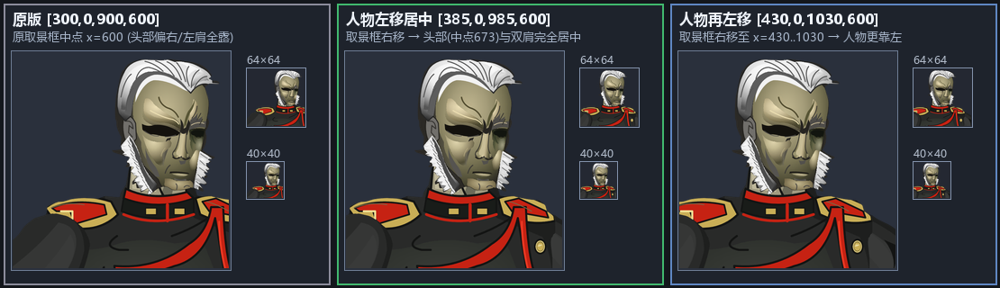

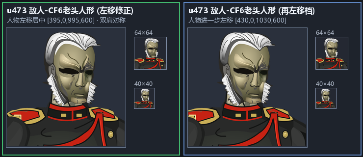

---

## 二、`敌人-武装JK` 双发色头像故障修复（已定稿）

### 1. 橙发变体（`敌人-武装JK::haircolor=orange`）
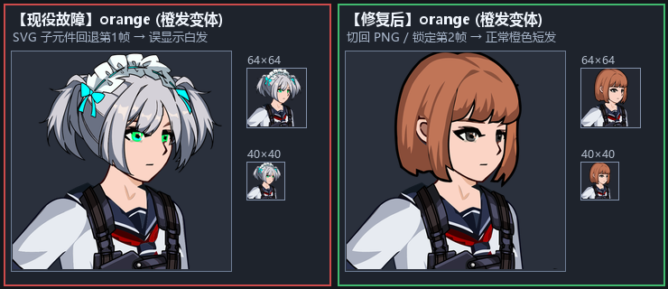

### 2. 白发变体（`敌人-武装JK::haircolor=white`）
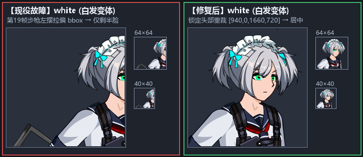

---

## 三、全部 14 个新单位定稿头像一览（`512×512` 直显）

| 单位 ID | 单位名称 (`identity_key`) | 定稿构图说明 | 定稿 `512×512` 图像直显 |
| :--- | :--- | :--- | :---: |
| **`u459`** | `敌人-延寿克隆兽` | 兽首+白色背棘+胸刺特写 `[500,80,1500,1080]` | 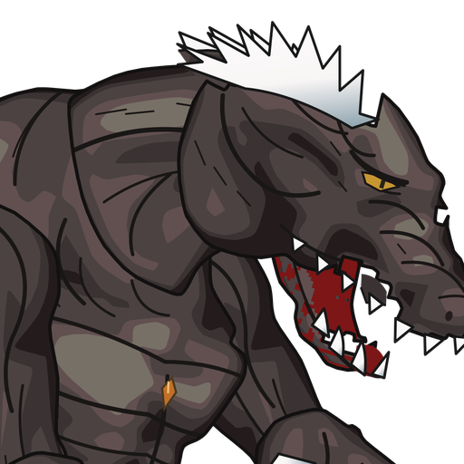 |
| **`u460`** | `敌人-完全体克隆兽` | 暗红兽首+白色背棘+胸刺特写 `[500,80,1500,1080]` | 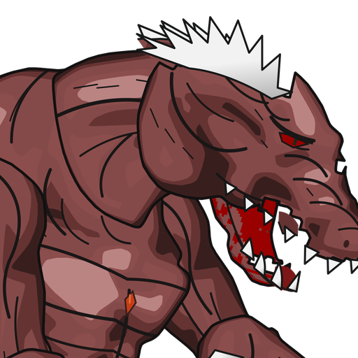 |
| **`u461`** | `敌人-CF6普通男僵尸` | 标准头肩特写 `[470,30,930,490]` | 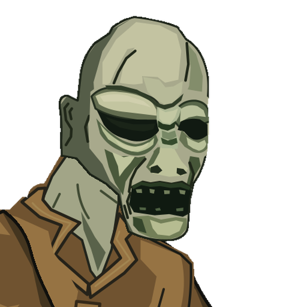 |
| **`u462`** | `敌人-CF6女僵尸` | 标准头肩特写 `[270,40,750,520]` | 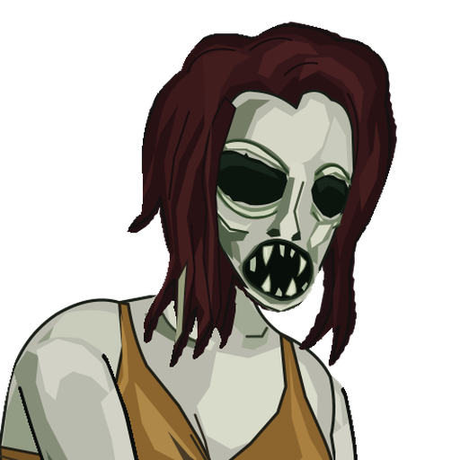 |
| **`u463`** | `敌人-CF6蛮蛮` | **方案 A（已锁定）**：头肩怒吼特写 `[950,470,1790,1310]` | 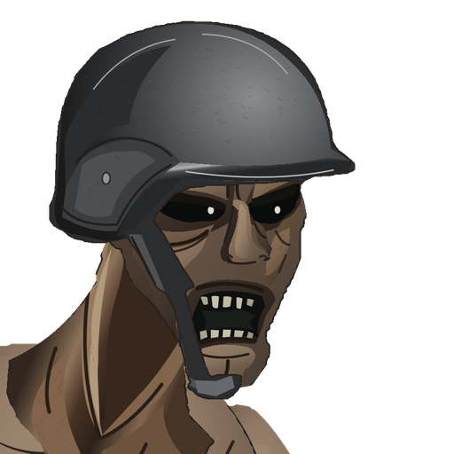 |
| **`u464`** | `敌人-CF6Wings` | 护目镜+胸前交叉双臂刀特写 `[270,160,1150,1040]` | 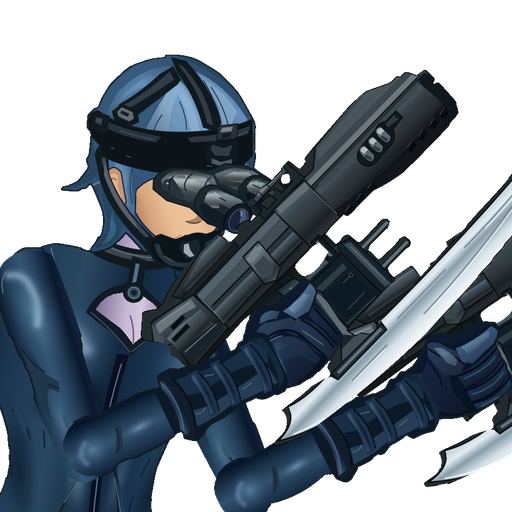 |
| **`u465`** | `敌人-CF6大刀机器人` | 紫色独眼机甲头+持刀双臂特写 `[1050,780,2850,2580]` | 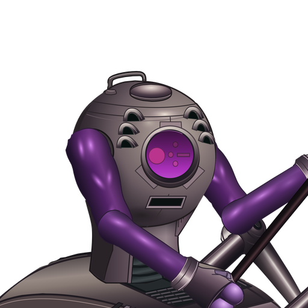 |
| **`u466`** | `敌人-CF6特种兵`（二阶段） | **方案 B（已锁定）**：防毒面具纯头肩特写 `[380,20,960,600]` | 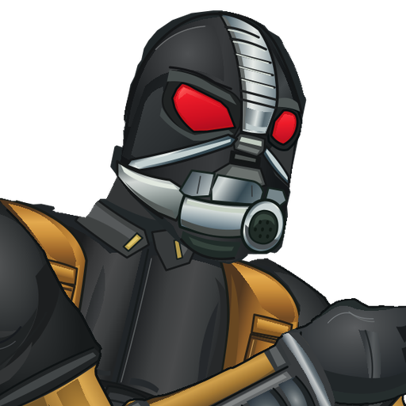 |
| **`u467`** | `敌人-CF6持盾特种兵`（一阶段） | **方案 A（已锁定）**：头盔+防暴盾观察窗特写 `[420,15,1100,695]` | 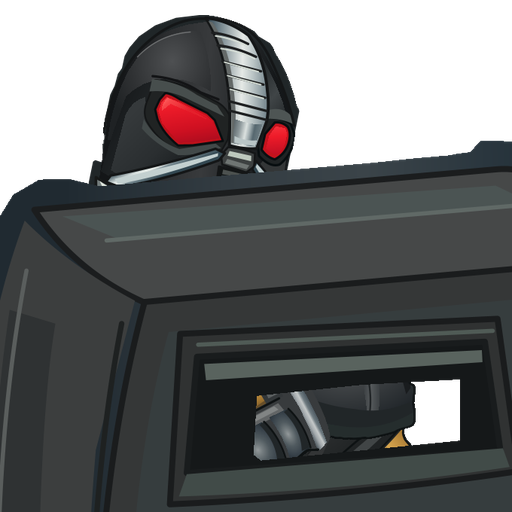 |
| **`u468`** | `敌人-CF6光头保安`（普通） | 墨镜西装+霰弹枪特写 `[160,380,840,1060]` | 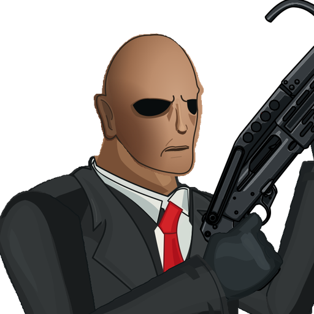 |
| **`u469`** | `敌人-CF6变身光头保安` | 变身第 45 帧暴君兽首破衣特写 `[1100,660,2120,1680]` |  |
| **`u472`** | `敌人-CF6大头机器人` | 全机体居中去地面阴影 `[0,40,2420,2460]` | 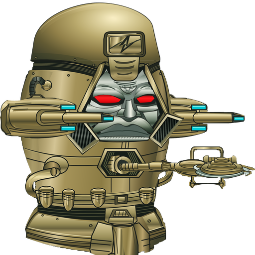 |
| **`u473`** | `敌人-CF6老头人形` | **人物左移居中修正**：`[395,0,995,600]`（备选再左移 `[430,0,1030,600]`） | 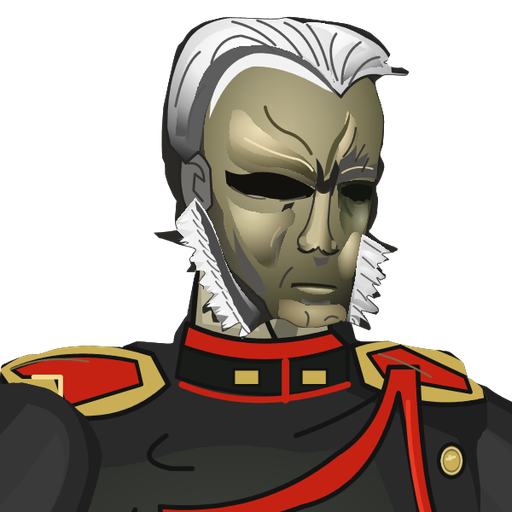 |
| **`u474`** | `敌人-CF6老头机器人` | **方案 A（已锁定）**：半机械改造头肩特写 `[560,110,1380,930]` | 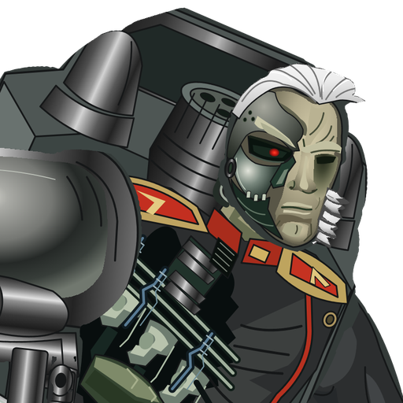 |
